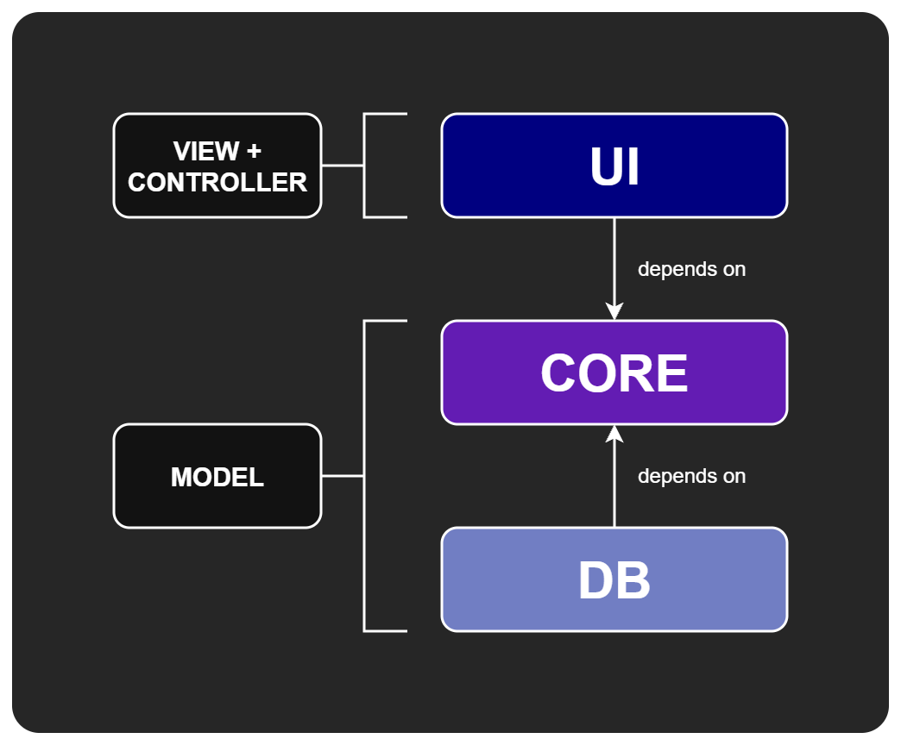

<!-- AUTO-GENERATED FILE: DO NOT EDIT MANUALLY -->

# 4. Design

**Storico delle versioni**

| Versione | Data | Autori | Descrizione delle modifiche |
| :--- | :--- | :--- | :--- |
| **0.1** | 17/11/2026 | Meoli Richard, Rapetti Giorgio | Stesura dell'introduzione relativa alle viste architettoniche, secondo il modello di *Krutchen*. |
| **0.2** | 18/11/2026 | Berardi Francesco, Meoli Richard | Stesura della parte del documento relativa allo stile architettonico e alle più importanti decisioni di progetto. |
| **1.0** | 26/11/2026 | Berardi Francesco, Meoli Richard | Annessione della sezione relativa ai design pattern utilizzati nel sistema. |

## 4.1 Architettura del software

### 4.1.1 Stile architettonico

La struttura del sistema si configura come un'architettura a **3 strati rigida**, le cui relazioni di dipendenza statica e la mappatura rispetto al modello *Model-View-Controller* (MVC) sono rappresentate nello schema seguente.

 
 

La tabella seguente formalizza la decisione relativa allo stile architetturale adottato.

| Elemento | Descrizione |
| :--- | :--- |
| **Problema** | Definire una struttura globale che separi nettamente l'interfaccia grafica, la logica di dominio (algoritmi di *Spaced Repetition*, gestione *Mazzi* e *Flashcard*,...) e la persistenza dei dati (archiviazione locale e sincronizzazione remota), garantendo alta coesione, basso accoppiamento, testabilità unitaria isolata e predisposizione a future estensioni verso nuove piattaforme. |
| **Decisione** | Adozione di un'architettura a **3 strati rigida**, combinata con lo stile **Model-View-Controller** per la strutturazione dello strato di UI e della sua interazione con il resto del sistema. |
| **Stato** | Approvato. |
| **Presupposti** |Il sistema è strutturato come applicazione Java multi-progetto gestita tramite Eclipse e Maven; le modifiche ai dati richiedono il salvataggio immediato in locale per prevenire perdite di lavoro offline. |
| **Alternative** | **1. MVC "piatto" con un unico componente *Model*:** scartata perché MVC, preso singolarmente, non separa le regole di dominio dalla logica di persistenza, ostacolando il testing isolato degli algoritmi e la sostituibilità del database. **2. Architettura a 3 strati rilassata:** scartata perché, dovendo garantire il salvataggio locale ad ogni modifica, quasi tutti i controllori dell'interfaccia avrebbero dovuto invocare direttamente il database, aumentando l'accoppiamento tra UI e DB e il rischio di disallineamenti tra stato applicativo in memoria e archivio locale. |
| **Motivazione** | **1. Basso accoppiamento:** nella versione rigida lo strato `kranki-ui` comunica esclusivamente con `kranki-core`, risultando completamente agnostico rispetto alle modalità di salvataggio. Il modulo `kranki-core` non dipende da alcun altro modulo del sistema, garantendo massima testabilità unitaria e riutilizzabilità. **2. Integrazione con MVC:** all'interno di `kranki-ui` si impone una netta separazione tra vista grafica e controllori degli eventi; il ruolo del *Model* di MVC non è lasciato a un blocco monolitico, ma è intenzionalmente stratificato in `kranki-core` e `kranki-db`. **3. Coesione dei moduli:** ciascun componente mantiene una responsabilità unica e ben delimitata, impedendo alla logica applicativa di disperdersi nei controllori grafici. |
| **Implicazioni** | **1. Modulo tecnico di _bootstrap_ (`kranki-app`):** poiché né `kranki-ui` né `kranki-core` dipendono da `kranki-db`, è necessario un quarto micro-progetto Maven privo di logica applicativa, dedicato esclusivamente all'istanziazione e al collegamento iniziale dei tre strati all'avvio. **2. Astrazioni e contenimento dei gestori:** `kranki-core` deve definire le interfacce astratte verso la persistenza (implementate da `kranki-db`) e un insieme limitato e coeso di gestori applicativi, evitando di svuotare le entità di dominio della loro logica intrinseca. **3. Aggiornamento documentazione di piano:** l'introduzione di `kranki-app` va tracciata rispetto alla ripartizione iniziale dei pacchetti di lavoro nel *Project Plan*. |
| **Appunti** | Nessuno. |

#### Componenti e connettori

* **Componenti:**
  * **Controllore:** i controllori di presentazione nello strato `kranki-ui`, che regolano la sequenza temporale delle interazioni dell'utente, insieme al modulo di _bootstrap_ `kranki-app`, che coordina l'inizializzazione dei componenti.
  * ***Manager*:** i gestori dello strato `kranki-core` (responsabili dei *Mazzi*, delle *Flashcard*, delle *Sessioni di studio*, dello storico *Undo/Redo*,...) e i gestori di persistenza e sincronizzazione di `kranki-db`.
  * **Computazionale:** il nucleo algoritmico per il calcolo degli intervalli e delle scadenze di ripasso (_SM-2_ ed *Exam Mode*), le unità di calcolo delle statistiche e di filtraggio/ricerca,...
  * **Memoria:** l'archivio locale persistente su file JSON (organizzato per singolo utente) e il database cloud *Firebase Realtime Database*, preposti al mantenimento strutturato e duraturo dei dati.
* **Connettori:**
  * **Chiamata di procedura:** connettore principale per le comunicazioni interne sincrone tra `kranki-ui`, `kranki-core` e `kranki-db`.
  * **Invocazione implicita:** meccanismo ad eventi nativo dell'interfaccia grafica JavaFX tra i componenti visivi e i controllori di presentazione.
  * **Passaggio di messaggio:** comunicazione su rete TCP/IP tramite protocollo HTTPS/REST con payload JSON tra il modulo `kranki-db` e i servizi remoti Firebase.
  * **Istanziazione:** creazione e collegamento iniziale dei moduli all'avvio dell'applicazione in `kranki-app` e istanziazione a runtime delle entità di dominio (*Mazzi*, *Flashcard*, *Sessioni di studio*,...) in `kranki-core`.
  * **Dati condivisi:** accesso allo spazio dati persistente remoto su *Firebase Realtime Database*, condiviso tra sessioni su dispositivi diversi dello stesso utente o tra più utenti nell'ambito dell'eventuale catalogo pubblico dei *Mazzi*.

### 4.1.2 Persistenza dei dati

La tabella seguente riassume le decisioni architetturali adottate per la persistenza locale, la sincronizzazione remota e l'autenticazione degli utenti.

| Elemento | Descrizione |
| :--- | :--- |
| **Problema** | Garantire autenticazione sicura per singolo utente, persistenza affidabile dei dati con pieno supporto all'utilizzo offline, sincronizzazione multi-dispositivo con gestione dei conflitti e importazione/esportazione su file locale, rispettando i vincoli del corso (utilizzo di Firebase come piattaforma remota). |
| **Decisione** | Adozione di una strategia basata su **archivio locale in formato JSON** abbinato a **Firebase Authentication** e **Firebase Realtime Database** su piano gratuito **Spark Plan**, integrati tramite **REST API** su HTTPS. |
| **Stato** | Approvato. |
| **Presupposti** | Assenza di budget finanziario, che vincola il progetto all'utilizzo di piani gratuiti; assenza di un meccanismo di _caching_ offline nativo di Firebase per applicazioni Java Desktop. |
| **Alternative** | **1. Sola memoria volatile + salvataggio remoto su richiesta:** scartata perché impedirebbe l'avvio e lo studio in assenza di rete, rallenterebbe l'apertura e aumenterebbe inutilmente il consumo di banda. **2. Database SQL + Firebase:** scartata per l'elevato onere implementativo dovuto alla gestione simultanea di due modelli dati differenti (relazionale e NoSQL). **3. Cloud Firestore / Firebase SQL Connect / Cloud Storage:** scartati rispettivamente per limiti operativi giornalieri su piano gratuito e formato REST complesso, per la natura temporanea del periodo di prova e per l'obbligo di piani a pagamento. |
| **Motivazione** | **1. Unificazione del formato dati:** l'impiego esclusivo del formato JSON consente di usare un unico meccanismo di serializzazione per archivio locale, cloud remoto e operazioni di *Import/Export*. **2. Affidabilità e reattività offline:** il salvataggio locale immediato per singolo *Mazzo* protegge da arresti anomali, garantisce avvio istantaneo e utilizzo completo senza connettività. **3. Adeguatezza di Realtime Database:** assenza di limiti giornalieri sul numero di letture/scritture, payload REST in JSON diretto e soglie molto ampie per singolo nodo. |
| **Implicazioni** | Separazione logica dei dati (testi, metadati e media) al fine di ridurre i trasferimenti di rete e contenere il consumo della banda mensile; gestione esplicita della rilevazione e risoluzione dei conflitti tramite marcatori temporali e azzeramento dello storico *Undo/Redo* al *Sync*; ridimensionamento lato client di eventuali immagini per restare nei limiti del piano gratuito. |
| **Appunti** | Nessuno. |

### 4.1.3 Interfaccia grafica

La tabella seguente formalizza la decisione relativa al framework adottato per lo sviluppo dell'interfaccia grafica.

| Elemento | Descrizione |
| :--- | :--- |
| **Problema** | Selezionare un framework Java GUI che assicuri layout dinamici adattabili a schermi di diverse risoluzioni, separazione netta tra interfaccia e logica, buona resa estetica realizzabile entro le scadenze del corso e apertura verso future evoluzioni dell'interfaccia (specie quelle relative all'editor di testo). |
| **Decisione** | Adozione del framework **JavaFX** supportato dal tool visuale **SceneBuilder**. |
| **Stato** | Approvato. |
| **Presupposti** | Applicazione Java Desktop sviluppata in Eclipse con Maven. |
| **Alternative** | **Java Swing:** integrato nel JDK; tuttavia, i suoi strumenti di progettazione visuale (es. *WindowBuilder*) generano codice Java che non favorisce nativamente la separazione MVC, il supporto HTML integrato è datato per l'evoluzione di un editor di *Flashcard* avanzato e sono richieste librerie esterne aggiuntive per realizzare i grafici delle statistiche. |
| **Motivazione** | **1. SceneBuilder e separazione MVC:** la progettazione visuale tramite SceneBuilder e viste dichiarative FXML separa fisicamente la parte grafica (*View*) dalla gestione degli eventi (*Controller*), attenuando al contempo la curva di apprendimento iniziale. **2. Evoluzione dell'editor:** il componente browser integrato consente un rendering avanzato di *Markdown* e formule *LaTeX*, lasciando aperta l'evoluzione post-esame verso uno strumento di scrittura più ricco. **3. Estetica e grafici integrati:** gli strumenti di styling di JavaFX (incluso il supporto ai fogli CSS) permettono di ottenere un'interfaccia curata con sforzo contenuto, mentre il supporto nativo ai grafici consente di realizzare la dashboard delle statistiche senza librerie esterne. |
| **Implicazioni** | **1. Impatto sull'ambiente:** introduce una dipendenza esterna non inclusa nel JDK e basata su librerie native, da configurare opportunamente per garantire la portabilità multipiattaforma. **2. Impatto sul team:** richiede una fase iniziale di familiarizzazione con il framework da parte del team. **3. Isolamento degli strati sottostanti:** per preservarne riutilizzabilità e testabilità, i moduli `kranki-core` e `kranki-db` devono rimanere completamente privi di dipendenze o riferimenti al framework JavaFX. |
| **Appunti** | Nessuno. |

### 4.1.4 Librerie esterne

TODO

### 4.1.5 Viste architetturali

La documentazione dell'architettura di un sistema software richiede l'adozione di molteplici prospettive, in quanto un'unica rappresentazione globale risulterebbe insufficiente per comunicare efficacemente con tutti gli *stakeholder*. Per rispondere a questa esigenza, la progettazione di *Kranki* adotta il modello architetturale "4+1" ideato da Philippe **Kruchten**. Tale scelta si integra naturalmente nel ciclo di vita adottato dal team, in quanto tale modello costituisce lo standard di riferimento del processo **RUP** (*Rational Unified Process*), il quale prevede inoltre un forte orientamento all'utilizzo della notazione UML. La descrizione del sistema si articola quindi in quattro punti di vista tecnici, affiancati da una quinta prospettiva trasversale che funge da collante logico.

#### Punto di vista logico
Descrive il sistema sotto il profilo concettuale, evidenziando gli elementi di progettazione principali del dominio applicativo e le loro relazioni. Tale vista è rivolta principalmente a illustrare come l'architettura soddisfi i requisiti funzionali attesi dall'utente finale.
* Diagramma delle classi: [link immagine](), [link file]()
* Diagramma di stato: [link immagine](), [link file]()

#### Punto di vista dell'implementazione
Fornisce una visione statica orientata agli sviluppatori e alla gestione del codice sorgente, illustrando la scomposizione del sistema in termini di moduli, pacchetti e livelli architetturali.
* Diagramma dei componenti: [link immagine](), [link file]()
* Diagramma dei package: [link immagine](), [link file]()

#### Punto di vista del processo
Rappresenta il comportamento dinamico del sistema in fase di esecuzione, focalizzandosi sul flusso delle attività, sui processi e sulle dinamiche di interazione e comunicazione temporale tra gli oggetti.
* Diagramma di sequenza: [link immagine](), [link file]()
* Diagramma di attività: [link immagine](), [link file]()
* Diagramma di comunicazione: [link immagine](), [link file]()

#### Punto di vista della distribuzione
Descrive l'architettura fisica del sistema, illustrando come gli artefatti software vengono distribuiti e allocati sui rispettivi nodi di esecuzione.
* Diagramma di deployment: [link immagine](), [link file]()

#### Punto di vista degli scenari (+1)
Raccoglie l'insieme dei casi d'uso fondamentali del sistema. Questa prospettiva guida l'intero processo di progettazione architetturale e svolge un ruolo di validazione e integrazione per gli altri quattro punti di vista tecnici.
* I diagrammi dei casi d'uso sono già stati inclusi nella sezione del documento dedicata alla descrizione dei requisiti del sistema.

## 4.2 Design pattern

A completamento delle scelte architetturali, la progettazione dettagliata di **Kranki** si fonda sull'adozione mirata di quattro *design pattern* classici. Ciascun pattern risponde a specifiche esigenze di flessibilità, separazione delle responsabilità e contenimento della complessità strutturale tra i moduli del sistema.

### 4.2.1 Strategy

#### Descrizione del pattern

Il pattern comportamentale **Strategy** affronta la necessità di dotare un componente applicativo (*Context*) di un comportamento o algoritmo che possa essere sostituito dinamicamente a *runtime*. Quando diverse varianti algoritmiche coesistono all'interno del medesimo processo, l'inclusione diretta della loro logica nel *Context* comprometterebbe l'estensibilità del sistema, costringendo a intervenire sul codice del chiamante ogni volta che viene introdotto un nuovo algoritmo o modificata una variante esistente.

La soluzione prevede l'estrazione delle singole famiglie algoritmiche in classi dedicate, governate da un'astrazione comune:
* **`Strategy`:** interfaccia comune che espone il contratto operativo attraverso cui l'algoritmo viene invocato.
* **`ConcreteStrategy`:** implementazioni concrete dell'interfaccia, ciascuna delle quali realizza una specifica variante dell'algoritmo.
* **`Context`:** classe che mantiene un riferimento all'interfaccia `Strategy` e delega a essa l'esecuzione dell'elaborazione richiesta, rimanendo ignara della classe concreta utilizzata.
* **`Client`:** componente responsabile di selezionare la `ConcreteStrategy` idonea allo scenario d'uso corrente e di associarla al `Context`.

#### Punto di applicazione in Kranki

Il pattern è applicato all'interno del modulo `kranki-core` per governare le logiche di programmazione dei ripassi:
* Nel package `core.scheduling`, l'interfaccia `SchedulingStrategy` definisce il contratto comune per il calcolo degli intervalli di revisione. Le classi `Sm2Scheduler` ed `ExamModeScheduler` fungono da *ConcreteStrategy*, implementando rispettivamente la variante adattata dell'algoritmo *SM-2* e la logica di compressione temporale della modalità *Exam Mode*. 
* Nel package `core.study`, `StudySession` opera nel ruolo di *Context*: interagisce esclusivamente mediante l'interfaccia `SchedulingStrategy`, utilizzandola sia per calcolare le quattro anteprime dei prossimi intervalli di ripasso esposte sui pulsanti di autovalutazione, sia per aggiornare l'entità di stato `ReviewProgress` (`core.model`) al termine della revisione di ciascuna *Flashcard*.
* Nel package `core.service`, `StudyService` agisce da *Client* nel momento dell'avvio di una *Sessione di studio*: in base alle impostazioni del `Deck` interessato — nello specifico, verificando l'eventuale presenza di una data limite `examDeadline` — seleziona la strategia opportuna e la associa all'istanza di `StudySession`.

#### Motivazione della scelta

L'adozione del pattern **Strategy** risulta determinante per mantenere elevata la qualità strutturale del nucleo algoritmico del sistema:
* **Contenimento della complessità ciclomatica:** in assenza di questo pattern, `StudySession` o le entità di dominio dovrebbero integrare catene di costrutti condizionali per discriminare tra ripasso standard ed *Exam Mode*, mescolando la gestione della coda di studio con le formule matematiche di scheduling. Estrarre le strategie consente di mantenere bassa e controllata la complessità ciclomatica sia di `StudySession` sia dei singoli scheduler.
* **Coesione, *Information Hiding* e testabilità unitaria:** ogni *ConcreteStrategy* isola al proprio interno i dettagli matematici del corrispondente algoritmo. Ciò rende ciascun algoritmo collaudabile in modo indipendente tramite test unitari.
* ***Open/Closed Principle*:** `StudySession` rimane chiusa rispetto a future modifiche della propria struttura interna ma aperta all'estensione comportamentale. L'eventuale integrazione futura di nuovi algoritmi di *Spaced Repetition* richiederà esclusivamente l'aggiunta di una nuova classe implementante `SchedulingStrategy` e il relativo criterio di selezione in `StudyService`, senza alcun impatto sul codice di gestione della sessione.

### 4.2.2 Delegation

#### Descrizione del pattern

Il pattern **Delegation** risponde al problema del riuso comportamentale tra classi quando una classe necessita di sfruttare funzionalità già implementate da un altro componente, ma il ricorso all'ereditarietà non risulta semanticamente corretto.

Il meccanismo si basa sulla composizione esplicita tra due ruoli principali:
* **`Delegator`:** classe che espone il servizio verso l'esterno ma, invece di reimplementarne l'intera logica o ereditarla da una superclasse, inoltra l'esecuzione delle sotto-operazioni opportune a un oggetto collaboratore incapsulato.
* **`Delegate`:** classe collaboratrice detenente la logica riutilizzabile che esegue l'operazione delegata per conto del `Delegator`.

#### Punto di applicazione in Kranki

Il pattern trova applicazione all'interno del motore di scheduling in `kranki-core`. `ExamModeScheduler` (*Delegator*) riceve per composizione un riferimento a `Sm2Scheduler` (*Delegate*). In occasione di ogni calcolo di anteprima o aggiornamento di stato, `ExamModeScheduler` non replica le regole convenzionali di apprendimento, ma delega a `Sm2Scheduler` l'elaborazione base secondo il modello *SM-2*, applicando successivamente al risultato ottenuto la propria logica di compressione progressiva in funzione della scadenza.

#### Motivazione della scelta

La scelta della delega tramite composizione è guidata dalle seguenti considerazioni progettuali:
* **Rispetto della relazione *is-a*:** far estendere `Sm2Scheduler` da parte di `ExamModeScheduler` violerebbe la semantica *is-a*, poiché la modalità *Exam Mode* può comprimere e alterare significativamente la naturale dilazione di *SM-2* e, in evoluzioni successive, potrebbe adottare formule autonome o appoggiarsi a un differente modello di base. La delega preserva una gerarchia piatta, evitando gli antipattern tipici della generalizzazione impropria.
* ***Information Hiding* e assenza di duplicazione:** `ExamModeScheduler` collabora con `Sm2Scheduler` unicamente attraverso l'interfaccia pubblica di quest'ultimo, senza dipendere dalla sua rappresentazione interna. Al contempo, si azzera la duplicazione della logica algoritmica di *SM-2*, che funge da base anche per l'algoritmo _Exam Mode_.

### 4.2.3 Observer

#### Descrizione del pattern

Il pattern comportamentale **Observer** risolve il problema dell'aggiornamento reattivo tra componenti che devono reagire ai cambiamenti di stato di un soggetto comune, evitando di legarli tramite associazioni dirette e rigide. Quando classi appartenenti a moduli o sottosistemi differenti si conoscono reciprocamente in modo concreto, la modifica o il riutilizzo di un componente comporta inevitabilmente ripercussioni sugli altri. L'adozione di questo pattern consente quindi di ridurre l'accoppiamento tra i componenti, favorendo una maggiore indipendenza e flessibilità.

Il pattern disaccoppia il produttore delle notifiche dai suoi consumatori mediante l'introduzione di un contratto astratto di osservazione:
* **`Observable`:** componente che mantiene l'elenco dinamico degli osservatori registrati (consentendone iscrizione e rimozione) e che si occupa di inviare una notifica al verificarsi di una variazione del suo stato.
* **`Observer`:** interfaccia astratta che espone il metodo di notifica invocato dall'`Observable` al cambio di stato.
* **`ConcreteObserver`:** implementazioni concrete interessate all'aggiornamento che si registrano presso l'`Observable` e reagiscono alle notifiche ricevute.

#### Punto di applicazione in Kranki

Si è scelto di ricorrere a tale pattern per gestire la comunicazione reattiva tra il nucleo di dominio e le schermate dell'interfaccia grafica. Di seguito sono approfonditi i dettagli di implementazione.
* **Infrastruttura di notifica (`core.observer`):** `WorkspaceObserver` definisce l'interfaccia *Observer*, mentre `WorkspaceNotifier` funge da *Observable* centralizzando la registrazione, la rimozione e la notifica degli osservatori.
* **Controller UI (`ui.controller`):** i tre controller delle schermate principali dell'applicazione (`MainController`, `BrowserController` e `StatsController`) assumono il ruolo di *ConcreteObserver*. Alla ricezione di un `WorkspaceEvent`, ciascun controller filtra l'evento in base al `WorkspaceEventType` e, se interessato, interroga il `Service` competente per acquisire i record aggiornati definiti in `core.dto`, pianificando il ridisegno dei componenti grafici. L'iscrizione e la disiscrizione da `WorkspaceNotifier` (mediate da `WorkspaceService`) sono gestite automaticamente in funzione del ciclo di vita grafico delle viste tramite `sceneProperty()`, prevenendo la permanenza di riferimenti pendenti alla chiusura delle schermate.

#### Motivazione della scelta

La configurazione adottata risponde a precisi vincoli architetturali:
* **Assenza di dipendenze circolari:** posizionare `WorkspaceObserver` e `WorkspaceNotifier` all'interno di `kranki-core`, lasciando i *ConcreteObserver* in `kranki-ui`, garantisce che tutte le dipendenze puntino esclusivamente dallo strato grafico verso il nucleo logico. In questo modo `kranki-core` non introduce alcuna dipendenza verso la UI, evitando cicli tra moduli.
* **Disaccoppiamento tra componenti:** l'adozione del pattern consente a chiunque introduca una modifica allo stato applicativo di non dover conoscere né mantenere riferimenti espliciti verso i componenti che devono aggiornarsi di conseguenza.
* **Efficienza e protezione dei confini:** la notifica leggera tramite `WorkspaceEvent` consente a ciascun controller di ignorare gli eventi non pertinenti ed evitare ricalcoli grafici superflui, mentre l'interrogazione successiva tramite i record immutabili di `core.dto` tutela l'*Information Hiding*, evitando di esporre lo stato interno delle entità di dominio ai controller UI.

### 4.2.4 Façade

#### Descrizione del pattern

Il pattern strutturale **Façade** risponde all'esigenza di gestire sottosistemi composti da molteplici classi e package interconnessi, che altrimenti costringerebbero i componenti chiamanti a conoscere e coordinare direttamente molte entità. Tale esposizione diretta rende complesso l'utilizzo del sottosistema e comporta che qualsiasi modifica alla sua struttura interna richieda una revisione delle classi che vi accedono.

Pertanto l'utilizzo del pattern semplifica l'accesso al sottosistema interponendo un punto d'ingresso unificato:
* **`Façade`:** classe che espone un'interfaccia di livello più alto, coesa e orientata ai casi d'uso verso i client esterni, delegando e orchestrando le chiamate verso gli elementi del sottosistema.
* **Classi interne del sottosistema:** componenti specializzati che realizzano la logica dettagliata e rimangono schermati rispetto ai chiamanti esterni.

#### Punto di applicazione in Kranki

Il pattern costituisce la spina dorsale di orchestrazione del sistema, ponendosi come punto d'ingresso e coordinamento unificato tra i diversi moduli applicativi. Nello specifico, all'interno del package `core.service`, i cinque `Service` applicativi (`AuthService`, `WorkspaceService`, `DeckService`, `StudyService` e `SyncService`) operano come vere e proprie facciate coese per area funzionale. Ricevute le richieste operative, ciascun `Service` maschera la complessità dell'architettura sottostante coordinando in modo integrato l'accesso allo stato della sessione in memoria e l'esecuzione delle regole sulle entità di dominio. Al contempo, il `Service` comanda direttamente le operazioni di persistenza locale e sincronizzazione remota invocando le opportune porte verso il database (`core.port`) e innesca la notifica degli aggiornamenti su `WorkspaceNotifier`, restituendo verso l'esterno esclusivamente viste dati immutabili tramite i `record` di `core.dto`.

#### Motivazione della scelta

L'introduzione di queste facciate è essenziale per tradurre in pratica l'architettura a 3 strati rigida che adotta il sistema:
* **Riduzione del *Coupling Between Objects* (`CBO`):** accentrando l'orchestrazione nei cinque `Service`, i componenti esterni della UI non devono conoscere o manipolare direttamente la complessa rete di collaboratori interni. I chiamanti interagiscono esclusivamente con la facciata del proprio ambito applicativo, riducendo la metrica di `CBO`.
* **Coerenza del flusso transazionale:** centralizzare l'orchestrazione nei `Service` assicura che ogni comando proveniente dall'interfaccia esegua in modo rigoroso la sequenza *validazione delle regole di dominio → persistenza locale immediata → notifica agli osservatori*, impedendo che i controller grafici alterino in modo incoerente lo stato volatile dell'applicazione rispetto all'archivio locale sul disco.
* **Elevata coesione:** suddividere il livello di servizio in cinque facciate focalizzate per area funzionale, anziché concentrare tutte le operazioni in un unico gestore monolitico centrale, mantiene elevata la coesione di ciascun `Service`, ne contiene la complessità ciclomatica, ne agevola la manutenzione e favorisce lo sviluppo parallelo.

### 4.2.5 Principi architetturali complementari

A completamento dei quattro *design pattern* principali, l'architettura adotta tre ulteriori principi per disciplinare l'interazione tra i diversi moduli:

* **`Dependency Inversion`:** i moduli centrali definiscono interfacce astratte che vengono poi realizzate dai moduli esterni. *Dove:* nelle porte di `core.port` (implementate in `kranki-db`) e in `WorkspaceObserver` (implementata in `kranki-ui`). *Motivo:* mantenere `kranki-core` isolato dai dettagli di salvataggio e grafica, evitando dipendenze circolari tra i moduli.
* **`Dependency Injection`:** i componenti applicativi, grafici e infrastrutturali non istanziano autonomamente le proprie dipendenze, ma le ricevono dall'esterno tramite i parametri del costruttore. *Dove:* nei cinque `Service`, nei repository/gateway di `kranki-db` e nei controller JavaFX tramite `ControllerFactory`. *Motivo:* rendere espliciti i legami tra componenti, collegare moduli indipendenti rispettando la *Dependency Inversion* e facilitare la sostituzione delle dipendenze nei test unitari.
* **`Composition Root`:** punto unico di avvio incaricato di istanziare e collegare tra loro i componenti condivisi dell'intero sistema. *Dove:* nella classe `KrankiApp` all'interno del modulo `kranki-app`. *Motivo:* confinare la conoscenza concreta di tutti i moduli in un solo punto privo di logica applicativa, evitando che gli altri strati debbano istanziarsi reciprocamente.
