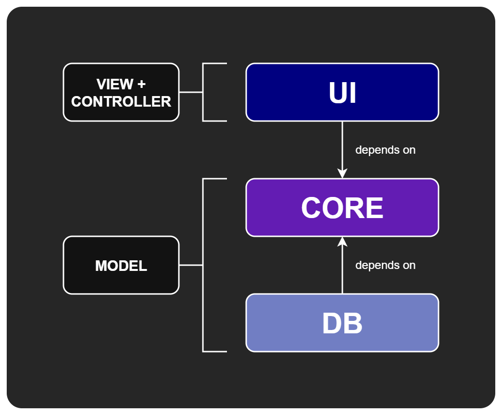

## 4.1 Architettura del software

### 4.1.1 Stile architettonico

La struttura del sistema si configura come un'architettura a **3 strati rigida**, le cui relazioni di dipendenza statica e la mappatura rispetto al modello *Model-View-Controller* (MVC) sono rappresentate nello schema seguente.

 
 

La tabella seguente formalizza la decisione relativa allo stile architetturale adottato.

| Elemento | Descrizione |
| :--- | :--- |
| **Problema** | Definire una struttura globale che separi nettamente l'interfaccia grafica, la logica di dominio (algoritmi di *Spaced Repetition*, gestione *Mazzi* e *Flashcard*,...) e la persistenza dei dati (archiviazione locale e sincronizzazione remota), garantendo alta coesione, basso accoppiamento, testabilità unitaria isolata e predisposizione a future estensioni verso nuove piattaforma. |
| **Decisione** | Adozione di un'architettura a **3 strati rigida**, combinata con lo stile **Model-View-Controller** per la strutturazione dello strato di UI e della sua interazione con il resto del sistema. |
| **Stato** | Approvato. |
| **Presupposti** |Il sistema è strutturato come applicazione Java multi-progetto gestita tramite Eclipse e Maven; le modifiche ai dati richiedono il salvataggio immediato in locale per prevenire perdite di lavoro offline. |
| **Alternative** | **1. MVC "piatto" con un unico componente *Model*:** scartata perché MVC, preso singolarmente, non separa le regole di dominio dalla logica di persistenza, ostacolando il testing isolato degli algoritmi e la sostituibilità del database. **2. Architettura a 3 strati rilassata:** scartata perché, dovendo garantire il salvataggio locale ad ogni modifica, quasi tutti i controllori dell'interfaccia avrebbero dovuto invocare direttamente il database, aumentando l'accoppiamento tra UI e DB e il rischio di disallineamenti tra stato applicativo in memoria e archivio locale.  |
| **Motivazione** | **1. Basso accoppiamento:** nella versione rigida lo strato `kranki-ui` comunica esclusivamente con `kranki-core`, risultando completamente agnostico rispetto alle modalità di salvataggio. Il modulo `kranki-core` non dipende da alcun altro modulo del sistema, garantendo massima testabilità unitaria e riutilizzabilità. **2. Integrazione con MVC:** all'interno di `kranki-ui` si impone una netta separazione tra vista grafica e controllori degli eventi; il ruolo del *Model* di MVC non è lasciato a un blocco monolitico, ma è intenzionalmente stratificato in `kranki-core` e `kranki-db`. **3. Coesione dei moduli:** ciascun componente mantiene una responsabilità unica e ben delimitata, impedendo alla logica applicativa di disperdersi nei controllori grafici. |
| **Implicazioni** | **1. Modulo tecnico di _bootstrap_ (`kranki-app`):** poiché né `kranki-ui` né `kranki-core` dipendono da `kranki-db`, è necessario un quarto micro-progetto Maven privo di logica applicativa, dedicato esclusivamente all'istanziazione e al collegamento iniziale dei tre strati all'avvio. **2. Astrazioni e contenimento dei gestori:** `kranki-core` deve definire le interfacce astratte verso la persistenza (implementate da `kranki-db`) e un insieme limitato e coeso di gestori applicativi, evitando di svuotare le entità di dominio della loro logica intrinseca. **3. Aggiornamento documentazione di piano:** l'introduzione di `kranki-app` va tracciata rispetto alla ripartizione iniziale dei pacchetti di lavoro nel *Project Plan*. |
| **Appunti** | Nessuno. |

#### Componenti e connettori

* **Componenti:**
  * **Controllore:** i controllori di presentazione nello strato `kranki-ui`, che regolano la sequenza temporale delle interazioni dell'utente, insieme al modulo di _bootstrap_ `kranki-app`, che coordina l'inizializzazione dei componenti.
  * ***Manager*:** i gestori dello strato `kranki-core` (responsabili dei *Mazzi*, delle *Flashcard*, delle *Sessioni di studio*, dello storico *Undo/Redo*,...), i gestori di persistenza e sincronizzazione di `kranki-db`.
  * **Computazionale:** il nucleo algoritmico per il calcolo degli intervalli e delle scadenze di ripasso (_SM-2_ ed *Exam Mode*), le unità di calcolo delle statistiche e di filtraggio/ricerca,... .
  * **Memoria:** l'archivio locale persistente su file JSON (organizzato per singolo utente) e il database cloud *Firebase Realtime Database*, preposti al mantenimento strutturato e duraturo dei dati.
* **Connettori:**
  * **Chiamata di procedura:** connettore principale per tutte le comunicazioni interne sincrone tra `kranki-ui`, `kranki-core` e `kranki-db` (quest'ultimo invocato dal Core tramite le interfacce astratte definite nello strato di dominio).
  * **Invocazione implicita:** meccanismo ad eventi nativo dell'interfaccia grafica JavaFX tra i componenti visivi e i controllori di presentazione.
  * **Passaggio di messaggio:** comunicazione su rete TCP/IP tramite protocollo HTTPS/REST con payload JSON tra il modulo `kranki-db` e i servizi remoti Firebase.
  * **Istanziazione:** creazione iniziale e iniezione delle dipendenze tra i macro-componenti all'avvio dell'applicazione (a carico di `kranki-app`), istanziazione controllata dei controllori grafici in `kranki-ui` e creazione a runtime delle entità di dominio (*Mazzi*, *Flashcard*, *Sessioni di studio*) in `kranki-core`.
  * **Dati condivisi:** accesso allo spazio dati persistente remoto su *Firebase Realtime Database*, condiviso tra sessioni su dispositivi diversi dello stesso utente o tra più utenti nell'ambito dell'eventuale catalogo pubblico dei mazzi.

### 4.1.2 Persistenza dei dati

La tabella seguente riassume le decisioni architetturali adottate per la persistenza locale, la sincronizzazione remota e l'autenticazione degli utenti.

| Elemento | Descrizione |
| :--- | :--- |
| **Problema** | Garantire autenticazione sicura per singolo utente, persistenza affidabile dei dati con pieno supporto all'utilizzo offline, sincronizzazione multi-dispositivo con gestione dei conflitti e importazione/esportazione su file locale, rispettando i vincoli del corso (utilizzo di Firebase come piattaforma remota). |
| **Decisione** | Adozione di una strategia basata su **archivio locale in formato JSON**  abbinato a **Firebase Authentication** e **Firebase Realtime Database** su piano gratuito **Spark Plan**, integrati tramite **REST API** su HTTPS. |
| **Stato** | Approvato. |
| **Presupposti** | Assenza di budget finanziario, che ci vincola all'utilizzo di piani gratuiti; assenza di un meccanismo di _caching_ offline nativo di Firebase per applicazioni Java Desktop. |
| **Alternative** | **1. Sola memoria volatile + salvataggio remoto su richiesta:** scartata perché impedirebbe l'avvio e lo studio in assenza di rete, rallenterebbe l'apertura e aumenterebbe inutilmente il consumo di banda. **2. Database SQL + Firebase:** scartata per l'elevato onere implementativo dovuto alla gestione simultanea di due modelli dati differenti (relazionale e NoSQL). **3. Cloud Firestore / Firebase SQL Connect / Cloud Storage:** scartati rispettivamente per limiti operativi giornalieri su piano gratuito e formato REST complesso, per la natura temporanea del periodo di prova e per l'obbligo di piani a pagamento. |
| **Motivazione** | **1. Unificazione del formato dati:** l'impiego esclusivo del formato JSON consente di usare un unico meccanismo di serializzazione per archivio locale, cloud remoto e operazioni di *Import/Export*. **2. Affidabilità e reattività offline:** il salvataggio locale immediato per singolo *Mazzo* protegge da arresti anomali, garantisce avvio istantaneo e utilizzo completo senza connettività. **3. Adeguatezza di Realtime Database:** assenza di limiti giornalieri sul numero di letture/scritture, payload REST in JSON diretto e soglie molto ampie per singolo nodo. |
| **Implicazioni** | Necessità di disaccoppiare logicamente i dati per ottimizzare il consumo della banda mensile gratuita; gestione esplicita della rilevazione e risoluzione dei conflitti tramite marcatori temporali e azzeramento dello storico *Undo/Redo* al *Sync*; ridimensionamento lato client di eventuali immagini per restare nei limiti del piano gratuito. |
| **Appunti** | Nessuno. |

### 4.1.3 Interfaccia grafica

La tabella seguente formalizza la decisione relativa al framework adottato per lo sviluppo dell'interfaccia grafica.

| Elemento | Descrizione |
| :--- | :--- |
| **Problema** | Selezionare il framework GUI Java per `kranki-ui` che assicuri layout dinamici adattabili a diverse risoluzioni, separazione netta tra interfaccia e logica, buona resa estetica entro le scadenze del corso e apertura verso future evoluzioni dell'editor di testo. |
| **Decisione** | Adozione di **JavaFX** (tramite viste dichiarative **FXML**, fogli di stile **CSS**, supporto visuale **SceneBuilder** e componente browser integrato **WebView**). |
| **Stato** | Approvato. |
| **Presupposti** | Sviluppo in Java con Eclipse e Maven. |
| **Alternative** | **Java Swing:** integrato nel JDK; tuttavia, i suoi strumenti di progettazione visuale (es. *WindowBuilder*) generano codice Java che non favorisce nativamente la separazione MVC, il supporto HTML integrato è datato per l'evoluzione di un editor di *Flashcard* avanzato e sono richieste librerie esterne aggiuntive per realizzare i grafici delle statistiche. |
| **Motivazione** | *1. **SceneBuilder e separazione MVC:** la progettazione visuale tramite SceneBuilder e viste dichiarative FXML separa fisicamente la parte grafica (*View*) dalla gestione degli eventi (*Controller*), attenuando al contempo la curva di apprendimento iniziale. 
2. **Evoluzione dell'editor:** il componente browser integrato consente un rendering avanzato di *Markdown* e formule *LaTeX*, lasciando aperta l'evoluzione post-esame verso uno strumento di scrittura più ricco. 
3. **Estetica e grafici integrati:** gli strumenti di styling di JavaFX (incluso il supporto ai fogli CSS) permettono di ottenere un'interfaccia curata con sforzo contenuto, mentre il supporto nativo ai grafici consente di realizzare la dashboard delle statistiche senza librerie esterne. |
| **Implicazioni** | 1. **Impatto sull'ambiente:** introduce una dipendenza esterna non inclusa nel JDK e basata su librerie native, da configurare opportunamente per garantire la portabilità multipiattaforma. 
2. **Impatto sul team:** richiede una fase iniziale di familiarizzazione con il framework da parte del team. 
3. **Isolamento degli strati sottostanti:** per preservarne riutilizzabilità e testabilità, i moduli `kranki-core` e `kranki-db` devono rimanere completamente privi di dipendenze o riferimenti al framework JavaFX. |
| **Appunti** | Nessuno. |

### 4.1.4 Librerie esterne

TODO
