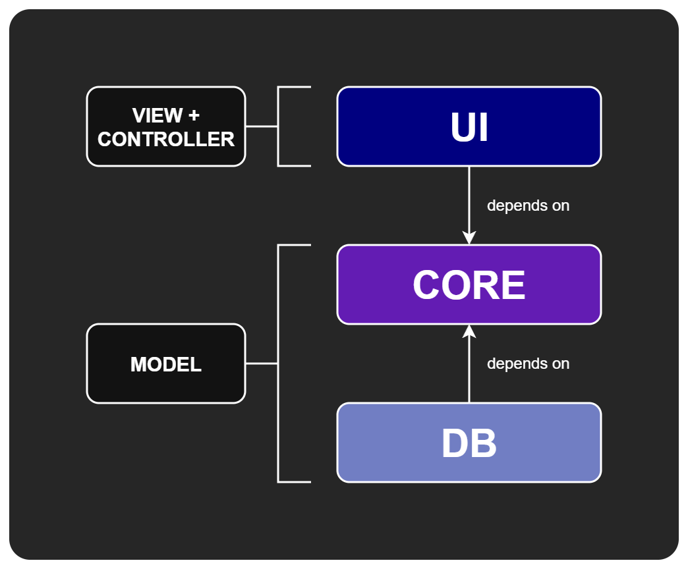

<!-- AUTO-GENERATED FILE: DO NOT EDIT MANUALLY -->

# Documentazione del progetto **Kranki**

* Introduzione al documento
* Indice dei contenuti

---

# 1. Project Plan

**Storico delle versioni**

| Versione | Data | Autori | Descrizione delle modifiche |
| :--- | :--- | :--- | :--- |
| **1.0** | 21/10/2026 | Berardi Francesco, Meoli Richard, Pullano Gabriele, Rapetti Giorgio | Redazione della prima versione completa del *Project Plan*. |
| **1.1** | 17/11/2026 | Meoli Richard, Rapetti Giorgio | Introduzione del modulo `kranki-app` per stratificazione rigida, aggiornamento della mitigazione sui conflitti di sincronizzazione e integrazione delle risorse GUI (JavaFX/SceneBuilder). |

## 1.1 Introduzione

### 1.1.1 Contesto del progetto
Il presente documento costituisce il *Project Plan* relativo al progetto sviluppato nell'ambito del corso di Ingegneria del Software (A.A. 2026/2027) presso l'Università degli Studi di Bergamo, su committenza del Prof. Angelo Gargantini e della Dott.ssa Silvia Bonfanti. 
Il team responsabile dell'intero ciclo di vita del software è composto dai seguenti membri:
* Berardi Francesco
* Meoli Richard
* Pullano Gabriele
* Rapetti Giorgio

### 1.1.2 Dominio applicativo
Il progetto si colloca nell'ambito degli strumenti software a supporto dello studio, basandosi su due fondamentali principi cognitivi: l'*Active Recall* (recupero attivo) e la *Spaced Repetition* (ripetizione dilazionata). Il primo consiste nello sforzo di recuperare un'informazione dalla memoria senza l'ausilio di suggerimenti passivi (come la semplice rilettura di un testo), una pratica implementata nel software tramite l'utilizzo delle *flashcard*, ossia carte virtuali tipicamente strutturate in formato domanda/risposta. Tale sforzo di memorizzazione è però fisiologicamente ostacolato dalla naturale "curva dell'oblio", che porta alla progressiva perdita delle nozioni nel tempo. Per contrastare questo fenomeno interviene la *Spaced Repetition*, una tecnica che programma i ripassi delle *flashcard* a intervalli di tempo via via crescenti. Tale approccio algoritmico ha lo scopo di stimolare la memoria esattamente nel momento in cui un'informazione sta per essere dimenticata, massimizzando così la ritenzione a lungo termine.

### 1.1.3 Origine dell'idea
L'idea alla base del progetto nasce dall'esperienza diretta del team come studenti e utilizzatori di strumenti digitali per l'apprendimento. Le soluzioni tradizionali basate su *flashcard* sono storicamente progettate per l'acquisizione di conoscenze su un orizzonte temporale indefinito. Pur rivelandosi eccellenti per questo scopo, tale logica tende a scontrarsi con le dinamiche accademiche, caratterizzate dalla perentorietà degli appelli d'esame. L'assenza di funzionalità native per vincolare i ripassi a una scadenza fissa costringe spesso lo studente ad alterare manualmente le tempistiche di revisione a ridosso dell'esame, compromettendo l'efficienza del ripasso.

### 1.1.4 Obiettivi del progetto
Per colmare questo divario nasce **Kranki**, un ambiente di studio basato su *flashcard* concepito per adattarsi alle esigenze universitarie e implementato come applicazione Java Desktop. Pur traendo ispirazione da soluzioni open-source consolidate come Anki, l'obiettivo primario del sistema è quello di fornire un motore di *Spaced Repetition* che introduca logiche di scheduling adattive, progettate per ricalibrare i cicli di revisione in funzione di scadenze temporali rigide imposte dall'utente. A questo obiettivo si affiancherà l'integrazione di meccaniche a supporto della costanza nello studio giornaliero, attraverso elementi di tracciamento dell'attività e gratificazione volti a sostenere la motivazione dello studente.

## 1.2 Modello di processo

### 1.2.1 Approccio metodologico
Il ciclo di vita del software adotterà un approccio metodologico ibrido, integrando il rigore formale del *Rational Unified Process* (RUP) con l'agilità del framework *Scrum*. Questa scelta strategica è guidata dalla necessità di coniugare i requisiti valutativi del progetto con l'efficienza dello sviluppo. Il RUP fornisce la struttura ideale per soddisfare le richieste relative alla progettazione orientata agli oggetti e alla modellazione UML; d'altra parte, *Scrum* garantisce la flessibilità e l'adattività necessarie per la gestione pratica della stesura del codice.

### 1.2.2 Fasi del ciclo di vita
L'evoluzione del progetto è strutturata secondo le quattro macro-fasi previste dal RUP:
* ***Inception* (Ideazione):** rappresenta la fase di avvio del progetto, dedicata interamente all'ingegneria dei requisiti, alla definizione dei confini del sistema e alla formulazione degli obiettivi principali che l'applicativo dovrà soddisfare.
* ***Elaboration* (Elaborazione):** fase incentrata sulla progettazione architetturale e sulla modellazione orientata agli oggetti. I diagrammi UML fungeranno da documentazione e linea guida per lo sviluppo. Verrà inoltre effettuata una parziale adozione del paradigma *Model-Driven Architecture* (MDA), utilizzata come supporto iniziale per generare automaticamente lo scheletro di alcune classi strutturali.
* ***Construction* (Costruzione):** fase operativa in cui avviene la stesura manuale del codice sorgente. Il processo abbandona l'impostazione sequenziale per adottare dinamiche fortemente iterative governate da *Scrum*: lo sviluppo avverrà tramite cicli brevi (*Sprint*), al termine dei quali verranno prodotti incrementi di software tangibili e funzionanti.
* ***Transition* (Transizione):** fase conclusiva del ciclo di vita, successiva al consolidamento del codice. Si focalizza sulla validazione complessiva dell'applicativo, sul *bug fixing* finale e sull'ottimizzazione del prodotto e della documentazione in vista della consegna.

## 1.3 Organizzazione del progetto

Questo capitolo descrive l'organizzazione generale del progetto, definendo i rapporti con le figure esterne e la divisione pratica dei compiti all'interno del team di sviluppo.

### 1.3.1 Relazioni esterne

* **Committenza:** rappresentata dal Prof. Angelo Gargantini e dalla Dott.ssa Silvia Bonfanti. Le comunicazioni formali e le richieste di approvazione per i documenti principali (come per il *Project Plan*) avverranno tramite l'apertura di *Issue* sul repository GitHub ufficiale del progetto.
* **Utenti finali:** chiunque abbia necessità di sfruttare i principi di memorizzazione supportati da applicazioni per la *spaced repetition*, in particolare gli studenti universitari. Poiché il team stesso fa parte di questa categoria, i membri del gruppo agiranno direttamente da "esperti di dominio", basandosi sulle proprie necessità reali per definire i requisiti (es. la gestione delle scadenze d'esame) e valutare la praticità dell'applicazione.

### 1.3.2 Organizzazione interna del team

Il gruppo di sviluppo è strutturato secondo il modello **Scrum**, composto da *developer* alla pari. La figura dello *Scrum Master* è ricoperta direttamente da uno degli sviluppatori, Giorgio Rapetti.

## 1.4 Standard, linee guida, procedure

Per garantire uniformità e ordine durante l'intero ciclo di sviluppo, il team si impegna a rispettare un set definito di regole e procedure interne.

### 1.4.1 Standard linguistici
È adottata una rigorosa separazione linguistica per evitare ambiguità:
* **Inglese:** lingua esclusiva per la nomenclatura nel codice sorgente, per i commenti *in-line* e per la generazione della documentazione tecnica *JavaDoc*.
* **Italiano:** lingua designata per la documentazione formale di progetto, per le comunicazioni interne sulle piattaforme di gestione e per i messaggi di commit.

### 1.4.2 Standard di codifica e ambiente di sviluppo
Lo sviluppo del codice Java rispetterà le *Java Code Conventions* definite da Oracle. L'ambiente di sviluppo integrato (IDE) standardizzato per tutti i membri del team è Eclipse, integrato con Maven per la gestione strutturata e condivisa delle dipendenze esterne.

### 1.4.3 Procedure di versionamento e collaborazione
Per la gestione del repository GitHub il team adotta l'approccio *Feature Branch Workflow*. L'intero flusso collaborativo è regolamentato e documentato nel file interno [CONTRIBUTING.md](https://github.com/RichardBoy05/Kranki/blob/main/CONTRIBUTING.md), che funge da riferimento per gli sviluppatori.

### 1.4.4 Linee guida per i commit
Per garantire la leggibilità e l'ispezionabilità della cronologia del repository, i messaggi di commit devono essere mantenuti sintetici e strettamente descrittivi dell'azione svolta, fornendo un riepilogo immediato delle modifiche applicate.

## 1.5 Attività di gestione

### 1.5.1 Pianificazione e monitoraggio dell'avanzamento

Il monitoraggio dello stato di avanzamento del progetto è supportato nativamente dagli strumenti di tracciamento offerti dalla piattaforma GitHub. Le attività da svolgere, formalizzate sotto forma di *Issue*, sono raggruppate in specifiche *Milestone* temporali.
\
La gestione dell'operatività è demandata a una *Kanban Board* di progetto, strutturata in cinque stati di avanzamento logici:

* **Product Backlog**: raccoglitore generale dei requisiti e delle attività stimate ma non ancora pianificate.

* **Sprint Backlog**: sottoinsieme di attività selezionate e assegnate per l'iterazione di sviluppo corrente.

* **Doing**: attività attualmente in carico e in fase di elaborazione da parte dei membri del team.

* **In Review**: attività completate dal punto di vista implementativo ma in attesa di validazione. Il passaggio logico a questo stato è innescato dall'apertura di una *Pull Request*.

* **Done**: attività validate, approvate durante la revisione e integrate definitivamente nel ramo principale del progetto (*merge*), decretando la chiusura formale del task.

### 1.5.2 Coordinamento del team e cicli di sviluppo

Il flusso di lavoro si articola in cicli iterativi di sviluppo (*Sprint*). Per garantire il costante allineamento operativo del team e valutare lo stato di salute del progetto, è stata adottata una politica di coordinamento strutturata su due livelli. 
\
Durante le fasi iniziali di ingegneria dei requisiti e progettazione architetturale, sono previsti incontri formali a cadenza settimanale (tipicamente fissati nella giornata di giovedì). Tali incontri si svolgono preferibilmente in presenza, o in alternativa mediante piattaforme VoIP (come Discord). Nella successiva fase di implementazione del codice, la cadenza degli incontri formali transiterà a una frequenza bisettimanale.
\
A questi incontri si affiancano dei brevi allineamenti giornalieri, svolti prevalentemente in presenza durante le consuete attività universitarie, al fine di condividere i progressi e risolvere tempestivamente eventuali problemi.

### 1.5.3 Bilanciamento dei vincoli progettuali

Un aspetto centrale dell'attività di gestione consiste nel continuo bilanciamento tra l'estensione dei requisiti implementati e i vincoli temporali imposti dal contesto accademico. Il progetto adotta un approccio rigorosamente *time-boxed*: le date di scadenza associate alle singole *Milestone* sono considerate inalterabili.
\
In caso di scostamenti rispetto alla pianificazione originaria o di criticità nello sviluppo, la gestione interviene operando uno snellimento dinamico dello *Sprint Backlog*. Ciò si traduce nella de-prioritizzazione o posticipazione delle attività secondarie, garantendo che le risorse del team convergano in modo esclusivo verso le funzionalità architetturali, assicurando un rilascio funzionante entro le scadenze concordate.

## 1.6 Rischi

Di seguito sono riportati i principali fattori di rischio previsti per il progetto, suddivisi in tre categorie, unitamente alle relative strategie di mitigazione.

### 1.6.1 Rischi funzionali

*   **Complessità dell'algoritmo di scheduling adattivo**\
    Comprimere gli intervalli di ripasso in funzione di una data d'esame prefissata comporta una notevole complessità algoritmica.\
    *Mitigazione:* nel caso in cui lo sviluppo di tale meccanismo risultasse incompatibile con le tempistiche del corso, si ripiegherà temporaneamente sul solo modello convenzionale (basato su SM-2), rimandando le logiche più avanzate a versioni successive.
*   **_Requirements creep_**\
    La naturale tendenza a integrare funzionalità non pianificate rischia di distogliere l'attenzione dalle priorità del progetto, compromettendo la realizzazione delle parti essenziali del sistema.\
    *Mitigazione:* applicazione preventiva del metodo MoSCoW, ammettendo lo sviluppo di eventuali requisiti emersi in corso d'opera solo a seguito del completamento delle funzionalità prioritarie.

### 1.6.2 Rischi tecnologici

*   **Conflitti di sincronizzazione multi-dispositivo**\
    La modifica concorrente dei dati su dispositivi diversi comporta il rischio di conflitti durante la sincronizzazione con il database remoto.\
    *Mitigazione:* qualora la risoluzione di tali problematiche si rivelasse impraticabile, ci si affiderà a una semplice politica di sovrascrittura esplicita (es. *Last-Write-Wins* basata su timestamp), accettando l'eventuale rischio di sovrascrittura.
*   **Sviluppo dell'interfaccia grafica**\
    L'implementazione di elementi grafici complessi, come un editor di testo avanzato, presenta difficoltà realizzative non trascurabili.\
    *Mitigazione:* se necessario, si adotteranno soluzioni più semplici, privilegiando il corretto funzionamento del sistema piuttosto che l'estetica.

### 1.6.3 Rischi organizzativi

*   **Curve di apprendimento**\
    L'integrazione di un database remoto come Firebase e lo studio di nuovi framework per la GUI richiederanno un importante sforzo di comprensione iniziale.\
    *Mitigazione:* se una specifica tecnologia dovesse richiedere un onere di apprendimento incompatibile con le tempistiche, si opterà per l'implementazione della soluzione più semplice disponibile (valutando, ad esempio, il ripiego verso un database *embedded* locale).
*   **Sovrapposizione con le attività accademiche**\
    La necessità di conciliare le attività di progetto con gli altri impegni universitari può incidere sulla continuità del lavoro.\
    *Mitigazione:* la pianificazione sarà gestita in modo flessibile, calibrando l'assegnazione dei compiti e le scadenze interne in funzione delle esigenze dei singoli membri.

## 1.7 Personale

### 1.7.1 Dimensionamento e modello operativo
L'organico del progetto è costituito dai quattro membri del team, il cui impiego è previsto con un *effort* costante per l'intera durata dei lavori. Sebbene la responsabilità sul prodotto finale sia collettiva, il team adotta una ripartizione delle mansioni flessibile, basata sull'ottimizzazione delle competenze tecniche individuali.

### 1.7.2 Evoluzione temporale delle competenze
Il profilo delle competenze richieste al team varierà dinamicamente in funzione delle fasi del ciclo di vita del software:
* **Analisi e progettazione**: impiego corale dell'intero team nel ruolo di analisti dei requisiti e architetti software.
* **Implementazione**: transizione verso ruoli tecnici incentrati sui vari *Work Packages*.
* **Verifica e validazione**: convergenza totale del team verso attività di *Quality Assurance* ed esecuzione dei test.

### 1.7.3 Aree di competenza primarie
Si precisa esplicitamente che l'assegnazione dei ruoli in fase di implementazione ha un valore puramente **indicativo**. In coerenza con le metodologie agili, il team opererà senza rigide compartimentazioni: ogni membro potrà intervenire e contribuire trasversalmente su qualsiasi modulo del sistema. 
Tuttavia, al solo fine di ottimizzare il coordinamento tecnico, vengono individuate le seguenti aree di focus primario:
* **Giorgio Rapetti**: *Scrum Master* e focus sul modulo *Core*.
* **Francesco Berardi**: Focus sul modulo *Core*.
* **Gabriele Pullano**: Focus sul modulo *Database*.
* **Richard Meoli**: Focus sul modulo *UI*.

## 1.8 Metodi e tecniche

Questa sezione descrive le metodologie che il team adotterà durante le diverse fasi del ciclo di vita del software.

### 1.8.1 Ingegneria dei Requisiti
Per definire le funzionalità del sistema, il team adotterà quattro tecniche principali:
* **Brainstorming:** i requisiti emersi verranno discussi dal team e classificati rigorosamente utilizzando il metodo **MoSCoW** (*Must, Should, Could, Won't have*), in modo da definire un perimetro di sviluppo chiaro e compatibile con le tempistiche del corso.
* **Etnografia:** l'etnografia prevede l'osservazione diretta degli utenti nel loro ambiente naturale al fine di far emergere abitudini consolidate e requisiti taciti difficilmente individuabili tramite altre tecniche. Nel nostro caso, tale analisi verrà applicata sotto forma di auto-osservazione, essendo i membri del team utilizzatori quotidiani di questi strumenti nel contesto universitario.
* **Derivazione da un sistema esistente:** verranno analizzati i software di *spaced repetition* esistenti (in particolare soluzioni consolidate come Anki) per derivare i requisiti base e identificare le aree di miglioramento.

### 1.8.2 Progettazione
La progettazione del sistema si baserà sulla modellazione **UML**.

## 1.9 Garanzia di qualità

Per assicurare che il software sviluppato rispetti elevati standard di affidabilità e manutenibilità, il team adotterà una strategia di *Quality Assurance* (QA) basata su tre pilastri fondamentali: analisi statica automatizzata, analisi dinamica tramite testing e revisione manuale.

### 1.9.1 Analisi statica del codice
Il controllo preventivo della qualità del codice sorgente sarà gestito attraverso la piattaforma ***SonarCloud***, integrata direttamente nel flusso di lavoro tramite Maven e supportata in locale dal plugin *SonarLint* per l'IDE Eclipse. Questo strumento fungerà da primo livello di controllo, rilevando in tempo reale *Code Smells*, bug potenziali e vulnerabilità di sicurezza. L'analisi statica provvederà inoltre a calcolare le principali metriche del software, ponendo per esempio attenzione alla misurazione della *Complessità Ciclomatica*, al fine di mantenere l'architettura del codice chiara e facilmente testabile.

### 1.9.2 Analisi dinamica e copertura 
La validazione funzionale del comportamento del software avverrà tramite la stesura di *Unit Test* utilizzando il framework ***JUnit***. Adottando un approccio di sviluppo tradizionale, la scrittura dei casi di test verrà effettuata a valle o contestualmente all'implementazione delle singole funzionalità. 
Per quantificare l'efficacia della suite di collaudo, la misurazione della *Code Coverage* (copertura del codice testato) sarà automatizzata attraverso l'integrazione del plugin ***JaCoCo*** all'interno del ciclo di build di Maven. I report generati da *JaCoCo* verranno trasmessi a *SonarCloud*, permettendo al team di monitorare costantemente la percentuale di codice validato dai test.

### 1.9.3 Revisione tra pari
Gli strumenti automatizzati saranno affiancati da un processo di validazione umana basato sulla *Code Review*. Tale revisione è obbligatoria per ogni *Pull Request* e deve essere rigorosamente effettuata da un membro del team diverso dall'autore delle modifiche. Questa ispezione incrociata agirà come un vero e proprio *Quality Gate* (cancello di qualità), garantendo l'identificazione di difetti logici, concettuali o architetturali che sfuggono alle analisi statiche e assicurando, al contempo, una conoscenza condivisa della *codebase* tra tutti gli sviluppatori.

## 1.10 Pacchetti di lavoro
L'organizzazione delle attività di sviluppo adotta una *Work Breakdown Structure* (WBS) allineata alla struttura architetturale del sistema. Il software è suddiviso in tre moduli funzionali principali, affiancati da un modulo di avvio, corrispondenti a quattro progetti Eclipse Maven sotto `kranki-parent`. Le attività si articolano nei seguenti *Work Packages* (WP).

*   **Core (`kranki-core`)**\
    Costituisce il nucleo logico dell'applicazione. Include principalmente la modellazione delle entità di dominio (mazzi, carte,...) e l'implementazione degli algoritmi per la *Spaced Repetition* e lo scheduling adattivo, unitamente ai vari servizi ausiliari. Il modulo non presenta alcuna dipendenza verso gli altri componenti interni del sistema.
*   **Database (`kranki-db`)**\
    Si occupa della persistenza locale e remota delle informazioni, delle operazioni di serializzazione per l'importazione/esportazione dei mazzi e dell'integrazione con i servizi esterni. L'adozione di un database remoto come *Firebase* risponde all'esigenza di consentire la sincronizzazione multi-dispositivo (con i necessari meccanismi di autenticazione correlati), predisponendo l'infrastruttura anche a un'eventuale estensione in ambito mobile. Il modulo dichiara una dipendenza da `kranki-core`.
*   **UI (`kranki-ui`)**\
    Dedicato allo sviluppo dell'interfaccia grafica, con l'obiettivo di offrire un'esperienza d'uso semplice e intuitiva. Il modulo dichiara una dipendenza da `kranki-core`.
*   **App (`kranki-app`)**\
    Modulo di avvio dell'applicazione, privo di logica applicativa o grafica, incaricato di inizializzare e collegare tra loro i moduli funzionali del sistema all'apertura dell'applicativo. Il modulo dipende da `kranki-core`, `kranki-db` e `kranki-ui`.

Tale ripartizione definisce la struttura e le dipendenze del software, ma non impone una rigida compartimentazione del personale durante lo sviluppo. Il team adotta infatti un modello di lavoro *cross-funzionale*: pur individuando per ciascun membro un'area di focus primario, è prevista una collaborazione trasversale sulle diverse attività.

## 1.11 Risorse

Il progetto prevede l'impiego delle seguenti risorse hardware e software.

### 1.11.1 Risorse hardware

Lo sviluppo e il test avverranno sui computer personali dei membri del team.

### 1.11.2 Risorse software

* **Ambienti di sviluppo:** Eclipse IDE.
* **Tool di modellazione:** StarUML v5.
* **Database remoto:** Firebase (tier gratuito "*Spark Plan*", sufficiente per l'impiego previsto).
* **Framework GUI:** JavaFX e SceneBuilder.

## 1.12 Budget e programma

### 1.12.1 Budget 
Il progetto non prevede l'allocazione di un budget finanziario, poiché verranno impiegati esclusivamente strumenti di sviluppo, framework ad accesso gratuito.
Il budget è pertanto quantificato unicamente in termini di *effort* (ore-uomo). Basandosi sulle stime fornite dalla committenza, si prevede un impiego complessivo di circa 120-160 ore-uomo (corrispondenti a un range di 30-40 ore per ciascun membro del team). 

### 1.12.2 Programma
Come già anticipato nel punto 2 del presente documento, la programmazione temporale del progetto si articolerà seguendo le quattro macro-fasi previste dal framework RUP. Lo sviluppo procederà dall'*Inception* per l'ingegneria dei requisiti, all'*Elaboration* per la progettazione architetturale, per poi passare alla fase operativa di *Construction*, che adotterà cicli iterativi (*Sprint*) per la stesura del codice. Il percorso si concluderà con la *Transition*, dedicata al testing intensivo e alla finalizzazione dei *deliverable* in vista della consegna formale.

## 1.13 Cambiamenti

Rispetto alla versione `1.0` approvata del *Project Plan*, nella revisione `1.1` sono state introdotte le seguenti modifiche:

* **Introduzione del modulo `kranki-app` e stratificazione rigida (Sez. 1.10):** per mantenere il pieno disaccoppiamento tra UI e persistenza anche con salvataggi locali frequenti, `kranki-ui` dipende ora esclusivamente da `kranki-core`, mentre il collegamento iniziale tra i moduli del sistema è demandato al modulo di avvio `kranki-app`.
* **Aggiornamento della strategia di fallback sui conflitti (Sez. 1.6.2):** adeguata la mitigazione all'integrazione di Firebase su Java Desktop, sostituendo il riferimento al comportamento predefinito di Firebase con una politica di sovrascrittura esplicita (es. *Last-Write-Wins*).
* **Integrazione delle risorse software (Sez. 1.11.2):** esplicitata l'adozione di JavaFX e SceneBuilder per la realizzazione dell'interfaccia grafica.

## 1.14 Consegna

Le procedure di rilascio e consegna del progetto al committente seguiranno rigorosamente le linee guida definite per la valutazione accademica. La consegna non prevederà l'invio di archivi compressi fisici, ma coinciderà in modo trasparente con lo stato finale della repository GitHub al termine della fase di consolidamento definitivo del codice.

---

# 2. Gestione del progetto

**Storico delle versioni**

| Versione | Data | Autori | Descrizione delle modifiche |
| :--- | :--- | :--- | :--- |
| **1.0** | 04/11/2026 | Pullano Gabriele | Redazione della prima versione completa del documento *Gestione del progetto*. |

## 2.1 Ciclo di vita del software

### 2.1.1 Processo di sviluppo
In conformità a quanto stabilito nel *Project Plan*, il team implementa un processo di sviluppo ibrido. La fase iniziale di analisi e progettazione segue le direttive del framework RUP (*Inception* ed *Elaboration*), concentrandosi sull'ingegneria dei requisiti e sulla modellazione del dominio. La successiva fase operativa di *Construction* viene gestita attraverso l'applicazione del framework agile *Scrum*. Infine, la fase di *Transition* è dedicata al testing di sistema integrato, alla risoluzione degli ultimi difetti e alla preparazione dell'applicativo per la consegna finale.

### 2.1.2 *Timebox* e pianificazione degli *Sprint*
La fase di stesura del codice è vincolata all'interno di *Sprint* di durata fissa pari a due settimane (14 giorni). Il calendario di sviluppo prevede quattro iterazioni principali, pianificate come segue:

| Iterazione   | Data Inizio      | Data Fine        | Obiettivo Principale |
| :----------- | :--------------- | :--------------- | :------------------- |
| **Sprint 1** | 19 Novembre 2026 | 03 Dicembre 2026 | TODO - da definire   |
| **Sprint 2** | 03 Dicembre 2026 | 17 Dicembre 2026 | TODO - da definire   |
| **Sprint 3** | 17 Dicembre 2026 | 31 Dicembre 2026 | TODO - da definire   |
| **Sprint 4** | 31 Dicembre 2026 | 14 Gennaio 2027  | TODO - da definire   |

*(Nota: gli obiettivi dei singoli Sprint sono puramente indicativi e si adattano dinamicamente in base alle priorità del Product Backlog).*

### 2.1.3 Approccio MDA
Durante la fase di *Elaboration*, il team adotta tecniche proprie del paradigma MDA limitandone l'applicazione allo sviluppo di parte del modulo centrale (`kranki-core`). Utilizzando il software di modellazione **StarUML**, viene disegnato il *Class Diagram* relativo al dominio applicativo. In seguito, sfruttando la funzionalità di generazione del codice integrata nel tool, una porzione del diagramma viene tradotta automaticamente nello scheletro Java delle entità fondamentali del sistema (es. `Deck`, `Flashcard`,...). Questo perimetro di applicazione mirato evita la generazione di codice *boilerplate* inutile nei moduli UI e DB, limitando l'intervento manuale degli sviluppatori alla sola implementazione della logica di business all'interno degli *Sprint*.

### 2.1.4 Formalizzazione della gestione delle *Change Request* / *Issue*
TODO - si può fare un *activity diagram*

## 2.2 Gestione della configurazione

### 2.2.1 Strumenti adottati
Come definito nelle procedure descritte all'interno del *Project Plan* (e documentate dettagliatamente nel file [CONTRIBUTING.md](https://github.com/RichardBoy05/Kranki/blob/main/CONTRIBUTING.md)), la gestione della configurazione, il versionamento del codice e la collaborazione tra i membri del team sono interamente gestiti tramite **GitHub**.
In particolare, per garantire la tracciabilità tra i requisiti e il codice effettivamente prodotto, il team sfrutta l'ecosistema integrato della piattaforma: ogni modifica al sistema è guidata da uno specifico *Issue*, il cui ciclo di vita è orchestrato visivamente tramite *Kanban Board*. Si collega l'avanzamento dei task ai relativi *branch* di sviluppo e alle *Pull Request*, assicurando un controllo totale sullo stato della configurazione del software.

### 2.2.2 Criteri di tracciamento e `.gitignore`
Per mantenere il repository pulito e privo di file generati localmente o non necessari all'esecuzione del codice su macchine diverse, è stato configurato un file `.gitignore` alla radice del progetto. Come da prassi per un progetto Java/Maven su Eclipse, il sistema è impostato per ignorare:
* I file binari compilati (`*.class`).
* Le cartelle di build generate da Maven (`target/`).
* Le impostazioni locali dell'IDE (`.settings/`).

Al contrario, i file fondamentali per l'importazione e la configurazione strutturale del progetto su altri ambienti, come i file `pom.xml` (per Maven) e il file nascosto `.project` (specifico per l'infrastruttura Eclipse), sono stati esplicitamente mantenuti.

### 2.2.3 Statistiche del repository
A dimostrazione dell'adozione continua degli strumenti di collaborazione (*Branch*, *Pull Request*, *Code Review* e *Kanban Board*), si riportano le statistiche globali del repository generate al termine della fase di sviluppo:

* **Numero totale di Commit:** [TODO: inserire numero a fine progetto]
* **Numero di *Issue* chiusi:** [TODO: inserire numero a fine progetto]

## 2.3 Gestione delle persone e organizzazione del team

### 2.3.1 Inquadramento del modello organizzativo
Il gruppo di lavoro adotta la configurazione di **Squadra Agile** declinata secondo il framework *Scrum*, scartando modelli fortemente rigidi o centralizzati. La struttura scelta si fonda sull'assenza di una gerarchia interna, su canali di comunicazione brevi e informali e su un'elevata autodisciplina dei singoli componenti. 

A integrazione dei ruoli di *Scrum Master* e *Development Team* già delineati nella pianificazione iniziale, la figura del ***Product Owner*** (responsabile della definizione delle funzionalità e della gestione del *Product Backlog*) viene assunta in modo condiviso dall'intero team di sviluppo. Essendo i membri del gruppo contemporaneamente sviluppatori ed esperti del dominio applicativo, le decisioni sulle priorità del prodotto vengono prese collettivamente.

### 2.3.2 Allocazione operativa del lavoro
Coerentemente con la natura auto-organizzata del team *Scrum*, la pianificazione e la distribuzione dei compiti durante gli *Sprint* non avvengono tramite assegnazione diretta dall'alto. All'avvio di ogni iterazione, il team si confronta per selezionare i compiti da inserire nello *Sprint Backlog*, attribuendo collettivamente a ciascun *Issue* un punteggio rappresentativo della difficoltà implementativa (*Story Points*). Questo meccanismo consente di misurare a fine *Sprint* il punteggio totale effettivamente realizzato (*Velocity*), permettendo al gruppo di verificare l'accuratezza delle proprie previsioni e di calibrare meglio il carico di lavoro per le iterazioni successive.

Una volta definito lo *Sprint Backlog*, i membri del team prelevano in autonomia gli *Issue* (auto-assegnazione). La scelta si orienta prevalentemente verso le rispettive aree di focus primario, in modo da ammortizzare le curve di apprendimento legate alle tecnologie specifiche di ciascun modulo, pur mantenendo la flessibilità necessaria per collaborare trasversalmente in caso di necessità.

---

# 3. Requisiti

**Storico delle versioni**

| Versione | Data | Autori | Descrizione delle modifiche |
| :--- | :--- | :--- | :--- |
| **1.0** | 12/11/2026 | Berardi Francesco, Meoli Richard, Pullano Gabriele, Rapetti Giorgio | Redazione della prima versione completa del documento *Requisiti* e dei diagrammi dei casi d'uso associati. |
| **1.1** | 17/11/2026 | Meoli Richard, Rapetti Giorgio | Precisazioni su persistenza locale immediata, sincronizzazione esplicita e ambito in memoria locale di *Undo/Redo* (`REQ-02`, `REQ-03`, `REQ-24`). |

## 3.1 Ingegneria dei requisiti

### 3.1.1 Introduzione

Kranki è un'applicazione dedicata allo studio tramite *Flashcard*, progettata per supportare, in particolare, lo studente universitario nella memorizzazione a lungo termine. A differenza delle soluzioni tradizionali, il sistema introduce un motore di *Spaced Repetition* capace di adattare i cicli di revisione a scadenze temporali rigide, come gli appelli d'esame. L'obiettivo è massimizzare l'efficienza dello studio, bilanciando la tecnica della ripetizione dilazionata con la necessità di una copertura totale del materiale entro date prestabilite.
La presente sezione del documento definisce le specifiche funzionali del sistema. La specifica dei requisiti è stata redatta in conformità con i principi dello standard **IEEE 830**, al fine di ridurre possibili ambiguità interpretative tra il team di sviluppo e gli *stakeholder*.

#### Glossario

Il seguente glossario contiene le definizioni dei termini tecnici di dominio utilizzati nella specifica dei requisiti.

| Termine            | Descrizione                                                                                                     |
| ------------------ | --------------------------------------------------------------------------------------------------------------- |
| *Archiviazione*      | Stato di un mazzo che ne interrompe la generazione delle scadenze, mantenendolo consultabile.    |
| *Browser*            | Interfaccia per consultare, ricercare e gestire le *Flashcard* di uno o più mazzi.                     |
| *Carta Invertita*    | Tipologia di *Flashcard* studiabile in entrambe le direzioni: fronte → retro e retro → fronte.             |
| *Cloze*              | Tipologia di *Flashcard* basata su un testo con una o più lacune da completare.                                      |
| *CORE*               | Modulo architettonico dedicato alla logica applicativa e alle regole di dominio.                                |
| *DB*                 | Modulo architettonico dedicato all'accesso ai dati e alla loro persistenza.                                     |                           |
| *Exam Mode*          | Algoritmo avanzato di compressione delle scadenze, che impone la revisione di tutte le *Flashcard* entro una data limite fissa. |
| *Flag*               | Marcatore visivo utilizzabile per evidenziare una *Flashcard*.                                                  |
| *Flashcard*          | L'unità base di studio dell'applicazione.                                                                       |
| *Fronte*             | La parte della *Flashcard* contenente la domanda.                                                   |
| *FSRS*               | Algoritmo avanzato di *Spaced Repetition* basato su un modello matematico della memoria per ottimizzare gli intervalli di ripasso.                                  |
| *Image Occlusion*    | Tipologia di *Flashcard* che verifica il riconoscimento di porzioni nascoste di un'immagine.                          |
| *LaTeX*              | Linguaggio di markup utilizzato per il rendering di formule matematiche.                                        |
| *Markdown*           | Linguaggio di markup utilizzato per la formattazione avanzata del testo.                                |
| *Mazzo*              | Contenitore logico che raggruppa una specifica collezione di *Flashcard*.                                         |
| *Milestone*          | Traguardo sbloccabile in base alle statistiche di studio.                                                       |
| *Nuova Flashcard*   | *Flashcard* non ancora sottoposta alla prima revisione da parte dell'utente.                                                       |
| *Reset*              | Azione che azzera i progressi registrati per una *Flashcard*.                                    |
| *Retro*              | La parte della *Flashcard* contenente la soluzione.                                                              |
| *Rollover*           | Orario di sistema che determina lo scatto al "nuovo giorno" ai fini del calcolo delle scadenze.                 |
| *Seppellimento*      | Esclusione temporanea di una *Flashcard* dalla sessione di studio, limitata alla giornata in corso.               |
| *Sessione di studio* | Attività in cui l'utente ripassa una sequenza di *Flashcard* selezionate dal sistema per un determinato *Mazzo*.                           |
| *Set Due Date*       | Forzatura manuale della data di scadenza di una *Flashcard*, sovrascrivendo il calcolo algoritmico.                    |
| *Skip*               | Spostamento di una *Flashcard* in fondo alla coda della sessione odierna, rimandandone il ripasso.          |
| *SM-2*               | Algoritmo di *Spaced Repetition* alla base del sistema di ripasso dell'applicazione.                                           |
| *Sospensione*        | Esclusione a tempo indeterminato di una *Flashcard*, fino a riattivazione manuale.                                |
| *Spaced Repetition*  | Tecnica di apprendimento che distribuisce i ripassi a intervalli temporali crescenti.                              |
| *Streak*             | Contatore dei giorni consecutivi in cui viene registrata una specifica attività nell'applicazione.         |
| *Tag*                | Etichetta testuale applicabile a una *Flashcard* per agevolarne la classificazione.                               |
| *Type in the Answer* | Tipologia di *Flashcard* che richiede la digitazione manuale della risposta.                    |
| *UI*           | Modulo architettonico dedicato all'interfaccia grafica.                                         |
| *Undo/Redo*          | Sistema che consente di annullare e ripristinare le azioni eseguite.                                |

### 3.1.2 Descrizione generale

La definizione dei requisiti è il risultato di un processo iterativo e multi-metodologico. Il team ha integrato diverse tecniche di elicitazione per coprire sia gli aspetti funzionali che quelli legati alla qualità dell'esperienza d'uso.

* **Derivazione da un sistema esistente**: è stata condotta un'analisi comparativa dei software di *Spaced Repetition* esistenti, con particolare focus su Anki. Tale approccio ha permesso di derivare il set di requisiti funzionali di base e di identificare potenziali criticità sulle quali intervenire con soluzioni migliorative.
* **Brainstorming**: il team ha organizzato sessioni di gruppo per far emergere idee e funzionalità innovative. In particolare, ciascun requisito è stato classificato mediante il metodo **MoSCoW**.
* **Etnografia**: poiché i membri del team sono utilizzatori quotidiani di strumenti di studio in ambito universitario, è stata applicata una forma di auto-osservazione. Questo ha permesso di far emergere esigenze tacite e abitudini consolidate che un'analisi puramente teorica avrebbe ignorato.

#### Documentazione UML: diagrammi dei casi d'uso

Durante la fase di ingegneria dei requisiti sono stati inoltre realizzati alcuni diagrammi dei casi d’uso, consultabili ai seguenti link.

| Casi d'uso | StarUML |
| :--- | :--- |
| [Gestione del sistema e dei _Mazzi_](https://github.com/RichardBoy05/Kranki/blob/main/docs/03-requirements/resources/01-gestione-account-dati-mazzi.jpg) | [Gestione del sistema e dei _Mazzi_](https://github.com/RichardBoy05/Kranki/blob/main/docs/03-requirements/resources/01-gestione-account-dati-mazzi.mdj) |
| [Gestione delle _Flashcard_](https://github.com/RichardBoy05/Kranki/blob/main/docs/03-requirements/resources/02-gestione-flashcard.jpg) | [Gestione delle _Flashcard_](https://github.com/RichardBoy05/Kranki/blob/main/docs/03-requirements/resources/02-gestione-flashcard.mdj) |
| [_Sessione di studio_, statistiche e gamification](https://github.com/RichardBoy05/Kranki/blob/main/docs/03-requirements/resources/03-sessione-studio-statistiche-gamification.jpg) | [_Sessione di studio_, statistiche e gamification](https://github.com/RichardBoy05/Kranki/blob/main/docs/03-requirements/resources/03-sessione-studio-statistiche-gamification.mdj) |

### 3.1.3 Requisiti specifici

| ID | Requisito | Criteri di accettazione | MoSCoW | Dipendenze | Issue GitHub | Rif. Codice | Rif. Test |
| :--- | :--- | :--- | :--- | :--- | :--- | :--- | :--- |
| **REQ&#8209;01** | **Registrazione e autenticazione** Il sistema deve consentire all'utente di creare un account e di autenticarsi, al fine di garantire l'accesso esclusivo ai propri *Mazzi*. L'autenticazione primaria deve avvenire tramite credenziali standard (indirizzo e-mail e password). Il sistema potrebbe opzionalmente supportare l'autenticazione tramite provider esterni.| L'accesso al sistema è consentito esclusivamente a seguito dell'inserimento di credenziali valide. In caso risultino errate, il sistema nega l'accesso e fornisce un riscontro visivo esplicativo all'utente, permettendo un nuovo tentativo di inserimento.|  | - | [#38](https://github.com/RichardBoy05/Kranki/issues/38)&nbsp;[UI]  [#39](https://github.com/RichardBoy05/Kranki/issues/39)&nbsp;[DB]  [#40](https://github.com/RichardBoy05/Kranki/issues/40)&nbsp;[CORE] | *TBD* | *TBD* |
| **REQ&#8209;02** | **Persistenza dei dati** Il sistema deve implementare un meccanismo di persistenza per garantire che i dati generati dall'utente (es. *Mazzi*, *Flashcard*, progressi di studio,...) vengano salvati in modo permanente, consentendo il ripristino e l'utilizzo dell'applicazione su dispositivi multipli. Tale requisito definisce le operazioni di salvataggio generiche su cui si appoggeranno le singole entità del dominio. Nello specifico, le modifiche ai dati vengono salvate immediatamente in un archivio locale (a supporto dell'utilizzo offline e del ripristino al riavvio), mentre l'allineamento con il database remoto avviene su esplicita richiesta di sincronizzazione. | Al riavvio dell'applicazione, il sistema recupera e consente di visualizzare i dati salvati dall'utente. In seguito alla richiesta di sincronizzazione, i dati locali vengono inviati in remoto, garantendo la coerenza delle informazioni tra dispositivi diversi. | | REQ&#8209;01 | [#41](https://github.com/RichardBoy05/Kranki/issues/41)&nbsp;[DB]| *TBD* | *TBD* |
| **REQ&#8209;03** | **Risoluzione dei conflitti di sincronizzazione** Il sistema potrebbe implementare un meccanismo per gestire eventuali disallineamenti tra i dati salvati localmente e quelli archiviati in remoto. Al rilevamento di uno stato di conflitto, il sistema richiede una decisione esplicita all'utente, permettendo di scegliere se sovrascrivere le informazioni remote con la versione locale oppure ripristinare i dati online. | Al verificarsi di un conflitto in fase di sincronizzazione, l'applicazione presenta un avviso per i dati interessati che richiede l'intervento manuale. Il sistema riprende il normale funzionamento solo a seguito di una scelta dell'utente in merito a quale delle due versioni conservare, azzerando l'eventuale storico locale di *Undo/Redo* al completamento dell'operazione. |  | REQ&#8209;02 | [#42](https://github.com/RichardBoy05/Kranki/issues/42)&nbsp;[UI]  [#43](https://github.com/RichardBoy05/Kranki/issues/43)&nbsp;[DB] | *TBD* | *TBD* |
| **REQ&#8209;04** | **Importazione ed esportazione locale** Il sistema dovrebbe permettere all'utente di esportare un proprio *Mazzo* su un file locale e di importare *Mazzi* a partire da file compatibili presenti sul dispositivo. L'esportazione dovrebbe preservare integralmente il contenuto delle *Flashcard*, inclusi il testo e gli eventuali elementi multimediali associati, garantendo la possibilità di effettuare backup manuali e di condividere il materiale di studio anche in assenza di connettività. | L'esportazione di un *Mazzo* genera un file locale conforme al formato supportato dall'applicazione. L'importazione di un file valido genera un nuovo *Mazzo* all'interno dell'applicazione, ripristinando fedelmente il contenuto delle *Flashcard* in esso contenute. A fronte di un file corrotto o non supportato, l'operazione viene annullata con un feedback visivo di errore. |  | REQ&#8209;07 | [#44](https://github.com/RichardBoy05/Kranki/issues/44)&nbsp;[UI]  [#45](https://github.com/RichardBoy05/Kranki/issues/45)&nbsp;[CORE] | *TBD* | *TBD* |
| **REQ&#8209;05** | **Condivisione pubblica dei _Mazzi_**  Il sistema potrebbe consentire di rendere pubblici i propri *Mazzi* all'interno della piattaforma, mettendoli a disposizione degli altri utenti. Attraverso una sezione dedicata, l'utente potrebbe esplorare il catalogo dei *Mazzi* condivisi e ottenerne una copia direttamente all'interno della propria libreria personale, favorendo uno scambio rapido di materiale di studio senza la necessità di trasferire manualmente file fisici. | Un *Mazzo* impostato come pubblico compare correttamente all'interno del catalogo condiviso. Il download di un elemento dal catalogo genera una copia autonoma nella schermata principale, assicurando che eventuali modifiche successive non alterino il *Mazzo* dell'autore originario. |  | REQ&#8209;02, REQ&#8209;07 | [#46](https://github.com/RichardBoy05/Kranki/issues/46)&nbsp;[UI]  [#47](https://github.com/RichardBoy05/Kranki/issues/47)&nbsp;[DB] | *TBD* | *TBD* |
| **REQ&#8209;06** | **Gestione dei _Mazzi_**  Il sistema deve mostrare all'utente l'interfaccia grafica principale dell'applicazione, dentro la quale è possibile creare, rinominare ed eliminare i *Mazzi*. | La creazione di un nuovo *Mazzo* o la modifica di uno esistente vanno a buon fine esclusivamente se l'utente fornisce un identificativo testuale non vuoto e non duplicato. L'operazione di eliminazione rimuove il *Mazzo* selezionato dalla vista e provoca la contestuale cancellazione di tutte le *Flashcard* associate e dei relativi storici di apprendimento. |  | - | [#48](https://github.com/RichardBoy05/Kranki/issues/48)&nbsp;[UI]  [#49](https://github.com/RichardBoy05/Kranki/issues/49)&nbsp;[CORE] | *TBD* | *TBD* |
| **REQ&#8209;07** | **Gestione della _Flashcard_**  Il sistema deve consentire la creazione e la modifica di una singola *Flashcard* all'interno di un *Mazzo* precedentemente selezionato. | L'utente può salvare o aggiornare una *Flashcard* compilando i campi *Fronte* (obbligatorio) e *Retro*. Qualora il *Fronte* sia vuoto, il sistema blocca l'operazione e segnala l'errore all'utente. |  | REQ&#8209;06 | [#54](https://github.com/RichardBoy05/Kranki/issues/54)&nbsp;[UI]  [#55](https://github.com/RichardBoy05/Kranki/issues/55)&nbsp;[CORE] | *TBD* | *TBD* |
| **REQ&#8209;08** | **Browser delle _Flashcard_**  Il sistema deve fornire un'interfaccia di *Browser* per permettere all'utente di ricercare, consultare, gestire e ordinare le varie *Flashcard* della collezione. | L'utente accede a un'interfaccia grafica adibita alla visualizzazione delle *Flashcard* di un *Mazzo* selezionato o dell'intera collezione. La selezione di una *Flashcard* abilita i comandi per la sua gestione. L'ordinamento avviene correttamente secondo i filtri specificati |  | REQ&#8209;07 | [#56](https://github.com/RichardBoy05/Kranki/issues/56)&nbsp;[UI] | *TBD* | *TBD* |
| **REQ&#8209;09** | **Editor di testo avanzato**  Il sistema dovrebbe fornire strumenti di formattazione del testo avanzati in fase di creazione e modifica di una *Flashcard*. Nello specifico, dovrebbe supportare l'utilizzo del linguaggio *Markdown* per la formattazione strutturale e del linguaggio *LaTeX* per la corretta visualizzazione di formule matematiche. | Durante l'inserimento o la modifica di una *Flashcard*, l'utente è in grado di utilizzare la sintassi avanzata e di visualizzarne un'anteprima che mostri correttamente gli elementi grafici e le formule matematiche. |  | REQ&#8209;07 | [#57](https://github.com/RichardBoy05/Kranki/issues/57)&nbsp;[UI] | *TBD* | *TBD* |
| **REQ&#8209;10** | **Supporto multimediale nelle _Flashcard_**  Il sistema potrebbe estendere le capacità dell'editor di testo supportando l'inserimento di immagini all'interno delle *Flashcard* (sia nel *Fronte* che nel *Retro*). | Incollando un'immagine dagli appunti di sistema all'interno dell'editor di testo, l'applicazione processa il file e ne mostra la corretta anteprima visiva, garantendone anche la persistenza. |  | REQ&#8209;02, REQ&#8209;07 | [#58](https://github.com/RichardBoy05/Kranki/issues/58)&nbsp;[UI]  [#59](https://github.com/RichardBoy05/Kranki/issues/59)&nbsp;[DB] | *TBD* | *TBD* |
| **REQ&#8209;11** | **Tipologie di _Flashcard_ speciali**  Il sistema potrebbe supportare alcune varianti di *Flashcard* diverse dal classico formato *Fronte*-*Retro*. Nello specifico, potrebbe implementare i modelli *Carta Invertita* e *Type in the Answer*. | In fase di creazione, l'utente può selezionare un modello speciale per la *Flashcard*. Durante una *Sessione di studio*, il sistema riconosce il modello e adatta l'interfaccia di conseguenza. |  | REQ&#8209;07 | [#60](https://github.com/RichardBoy05/Kranki/issues/60)&nbsp;[UI]  [#61](https://github.com/RichardBoy05/Kranki/issues/61)&nbsp;[CORE] | *TBD* | *TBD* |
| **REQ&#8209;12** | **Tipologie di _Flashcard_ avanzate**  Il sistema potrebbe estendersi per supportare modelli di *Flashcard* di difficile implementazione, tra cui i modelli *Cloze* e *Image Occlusion*. | - |  | REQ&#8209;07 | - | - | - |
| **REQ&#8209;13** | **Algoritmo standard di _Spaced Repetition_**  Il sistema deve programmare dinamicamente gli intervalli di revisione per ciascuna delle *Flashcard*, basandosi sulla valutazione soggettiva espressa dall'utente durante i vari ripassi. Il motore logico consisterà in una versione adattata dell'algoritmo *SM-2*. | A seguito della valutazione di una *Flashcard* da parte dell'utente, i parametri interni e la data di scadenza della stessa vengono aggiornati secondo le regole matematiche dell'algoritmo. L'interfaccia grafica mostra correttamente un'anteprima del prossimo intervallo temporale di ripasso generato dall'algoritmo, per ciascun livello di valutazione disponibile. |  | REQ&#8209;07 | [#62](https://github.com/RichardBoy05/Kranki/issues/62)&nbsp;[CORE] | *TBD* | *TBD* |
| **REQ&#8209;14** | **Algoritmo _Exam Mode_**  Il sistema deve fornire una modalità di programmazione dei ripassi alternativa all'algoritmo di base, ottimizzata per la gestione dello studio in presenza di scadenze inderogabili. Qualora l'utente assegni una data di scadenza a un determinato *Mazzo* (ad esempio, la data di un appello universitario), il motore algoritmico deve essere in grado di comprimere dinamicamente gli intervalli temporali di revisione, assicurandosi che tutte le *Flashcard* del *Mazzo* vengano riproposte prima del raggiungimento della data limite. | Impostata una scadenza per un *Mazzo*, a seguito di una qualsiasi valutazione su una *Flashcard*, la nuova data di revisione è matematicamente vincolata a verificarsi prima della data limite, sovrascrivendo la naturale dilazione dell'algoritmo base. |  | REQ&#8209;13 | [#63](https://github.com/RichardBoy05/Kranki/issues/63)&nbsp;[CORE] | *TBD* | *TBD* |
| **REQ&#8209;15** | **Algoritmi di scheduling avanzati**  Il sistema potrebbe estendersi per accogliere logiche matematiche aggiuntive di ottimizzazione dei ripassi, tra cui l'algoritmo *FSRS*. | - |  | REQ&#8209;07 | - | - | - |
| **REQ&#8209;16** | **Esecuzione della _Sessione di studio_**  Il sistema deve permettere all'utente di avviare una *Sessione di studio* relativa a un determinato *Mazzo*. L'interfaccia deve presentare inizialmente solo il *Fronte* della *Flashcard*. Su richiesta dell'utente, il sistema deve mostrare il *Retro* contestualmente ai pulsanti di autovalutazione, fungendo da innesco per il ricalcolo algoritmico. | Avviata una *Sessione di studio*, l'utente visualizza le *Flashcard* in scadenza, una alla volta. A seguito della pressione di un tasto di valutazione, la *Flashcard* corrente viene rimossa dalla visualizzazione, i dati vengono elaborati in background dall'algoritmo di *Spaced Repetition* e il sistema presenta la successiva *Flashcard* in coda. |  | REQ&#8209;13 | [#64](https://github.com/RichardBoy05/Kranki/issues/64)&nbsp;[UI]  [#65](https://github.com/RichardBoy05/Kranki/issues/65)&nbsp;[CORE] | *TBD* | *TBD* |
| **REQ&#8209;17** | **Azioni di controllo avanzate sulle _Flashcard_**  Il sistema dovrebbe consentire all'utente di eseguire alcune azioni di controllo sulle singole *Flashcard*, sia durante una *Sessione di studio* che tramite l'interfaccia del *Browser*. Nello specifico, il sistema dovrebbe supportare le azioni di: *Sospensione*, *Seppellimento*, *Skip*, *Flag*, *Tag*, *Set Due Date* e *Reset*. | Le azioni eseguite dall'utente mutano con successo lo stato e i metadati della *Flashcard* selezionata. Durante una *Sessione di studio*, il sistema di accodamento rispetta tali variazioni, escludendo dalla visualizzazione le *Flashcard* che subiscono una *Sospensione* o un *Seppellimento*, e riproponendo solo al termine della sessione quelle marcate con *Skip*. |  | REQ&#8209;08, REQ&#8209;16 | [#66](https://github.com/RichardBoy05/Kranki/issues/66)&nbsp;[UI]  [#67](https://github.com/RichardBoy05/Kranki/issues/67)&nbsp;[CORE] | *TBD* | *TBD* |
| **REQ&#8209;18** | **_Sessioni di studio_ personalizzate**  Il sistema potrebbe estendersi permettendo la generazione di *Sessioni di studio* personalizzate o di *Mazzi* temporanei filtrati, per garantire all'utente una maggiore flessibilità. | - |  | REQ&#8209;16 | - | - | - |
| **REQ&#8209;19** | **Impostazioni del _Mazzo_**  Il sistema dovrebbe consentire all'utente di personalizzare le proprietà di uno specifico *Mazzo*. Nello specifico, dovrebbe essere possibile: impostare un limite massimo giornaliero di *Nuove Flashcard*; attivare la modalità *Exam Mode* indicando una data di scadenza; procedere all'*Archiviazione* di un *Mazzo* completato. | A fronte dell'impostazione di un limite giornaliero su un *Mazzo*, il sistema non accoda ulteriori *Nuove Flashcard* nella *Sessione di studio* corrente una volta raggiunta la soglia. Un *Mazzo* posto in *Archiviazione* cessa di mostrare nuove scadenze e scompare dalle viste principali fino all'eventuale ripristino manuale da parte dell'utente. |  | REQ&#8209;06 | [#68](https://github.com/RichardBoy05/Kranki/issues/68)&nbsp;[UI] | *TBD* | *TBD* |
| **REQ&#8209;20** | **Preferenze globali di sistema**  Il sistema potrebbe fornire all'utente un'interfaccia per la gestione delle preferenze globali. In tale contesto, l'utente potrebbe personalizzare la lingua del sistema (italiano o inglese) e ridefinire l'orario di *Rollover*. Il sistema potrebbe inoltre fornire opzioni per il *Seppellimento* automatico delle *Nuove Flashcard* al momento della loro creazione e un comando globale per *Seppellire* in blocco tutte le *Nuove Flashcard* presenti nella coda odierna. | La modifica della lingua comporta l'aggiornamento testuale dell'intera applicazione. La personalizzazione del *Rollover* altera correttamente l'orario del "cambio giorno". I vari comandi o automatismi inclusi svolgono correttamente il proprio compito. |  | - | [#69](https://github.com/RichardBoy05/Kranki/issues/69)&nbsp;[UI] | *TBD* | *TBD* |
| **REQ&#8209;21** | **Dashboard delle statistiche e timer di studio**  Il sistema dovrebbe permettere all'utente di consultare l'andamento del proprio studio attraverso una dashboard analitica che aggreghi vari tipi di dati storici. A supporto di tali metriche, il sistema dovrebbe implementare un timer in background attivo durante ogni *Sessione di studio*, capace di misurare il tempo di risposta per la singola *Flashcard*, con l'accortezza di sospendere il conteggio in caso di inattività prolungata per preservare l'affidabilità dei dati. | L'utente visualizza riepiloghi grafici o numerici coerenti con il reale storico delle valutazioni effettuate. Durante lo studio, il tempo registrato per la singola *Flashcard* riflette il tempo effettivo trascorso tra l'esposizione del *Fronte* e l'autovalutazione, tralasciando eventuali periodi di inattività che eccedano la soglia preimpostata dal sistema. |  | REQ&#8209;02, REQ&#8209;16 | [#70](https://github.com/RichardBoy05/Kranki/issues/70)&nbsp;[UI]  [#71](https://github.com/RichardBoy05/Kranki/issues/71)&nbsp;[CORE] | *TBD* | *TBD* |
| **REQ&#8209;22** | **Gamification**  Il sistema potrebbe integrare logiche di gamification al fine di incentivare la costanza giornaliera dell'utente, tramite meccanismi come *Streak* e *Milestone*. | Le *Streak* e le *Milestone* riflettono coerentemente l'attività di studio svolta in precedenza dall'utente. |  | REQ&#8209;21 | [#72](https://github.com/RichardBoy05/Kranki/issues/72)&nbsp;[UI]  [#73](https://github.com/RichardBoy05/Kranki/issues/73)&nbsp;[CORE] | *TBD* | *TBD* |
| **REQ&#8209;23** | **Keyboard Shortcuts**  Il sistema dovrebbe supportare una mappatura fissa di scorciatoie da tastiera, al fine di permettere all'utente di eseguire comodamente le azioni di sistema più frequenti. | Le scorciatoie da tastiera implementate si traducono nelle azioni previste durante l'uso dell'applicazione. |  | REQ&#8209;08, REQ&#8209;16 | [#74](https://github.com/RichardBoy05/Kranki/issues/74)&nbsp;[UI] | *TBD* | *TBD* |
| **REQ&#8209;24** | **Sistema globale di _Undo/Redo_**  Il sistema potrebbe implementare un meccanismo di *Undo/Redo* per annullare o ripristinare le operazioni strutturali eseguite dall'utente. Tale funzionalità opera a livello globale di applicazione, distinguendosi dal comune annullamento presente nell'editor di testo. Tale meccanismo opera esclusivamente sui dati della sessione corrente in memoria locale (aggiornando di riflesso l'archivio locale ma senza interagire con il database remoto) e viene azzerato alla chiusura della sessione o all'esecuzione di una sincronizzazione remota. | L'invocazione del comando di *Undo* o di *Redo* ripristina fedelmente lo stato dei dati e dell'interfaccia a quello immediatamente antecedente o successivo all'operazione eseguita dall'utente. Alla chiusura della sessione o a seguito di una sincronizzazione remota, lo storico delle operazioni annullabili/ripristinabili risulta azzerato. |  | - | [#75](https://github.com/RichardBoy05/Kranki/issues/75)&nbsp;[CORE] | *TBD* | *TBD* |
| **REQ&#8209;25** | **Estensione a dispositivi mobili**  Il sistema potrebbe estendersi per essere distribuito sotto forma di applicazione nativa per dispositivi mobili o come client web. | - |  | - | - | - | - |

## 3.2 Qualità del software

La progettazione, lo sviluppo e la valutazione qualitativa del sistema Kranki sono stati condotti adottando la **Tassonomia di McCall**, preferita allo standard ISO 9126 per la sua chiara organizzazione in macro-categorie. Tale framework permette infatti di declinare oggettivamente la qualità del software secondo tre aree distinte: il funzionamento operativo del sistema (*Product Operations*), le necessità tecniche del team di sviluppo (*Product Revision*) e il ciclo di vita del prodotto in relazione all'ambiente di esecuzione (*Product Transition*). In particolare, per il contesto del progetto, si è scelto di privilegiare i seguenti fattori di qualità.

### 3.2.1 Product operations
Questa categoria raccoglie i fattori qualitativi legati all'utilizzo quotidiano del sistema da parte dello studente.

* **Usabilità**: il sistema deve minimizzare il carico cognitivo associato all'interazione con l'interfaccia, permettendo all'utente di mantenere il focus esclusivamente sull'apprendimento.\
  *Verificabilità*: implementazione pervasiva di scorciatoie da tastiera (*keyboard shortcuts*), al fine di garantire allo studente la possibilità di completare un'intera sessione di ripasso comodamente.
* **Affidabilità**: i progressi di studio rappresentano il dato critico del sistema e non devono subire alterazioni o perdite in caso di anomalie hardware o software.\
  *Verificabilità*: adozione di meccanismi di salvataggio e persistenza sicura dei dati, in locale e in remoto.
* **Integrità**: i dati personali e i mazzi di carte dello studente devono essere protetti da accessi o manipolazioni non autorizzate.\
  *Verificabilità*: implementazione di un sistema di autenticazione mediante credenziali, atto a vincolare l'accesso ai dati salvati esclusivamente al legittimo proprietario.

### 3.2.2 Product revision
Questa categoria riflette l'attitudine del software a essere analizzato, manutenuto ed evoluto dal team di sviluppo.

* **Manutenibilità**: il codice sorgente deve prevenire il degrado architetturale, mantenendosi leggibile e rigorosamente strutturato per agevolare lo sviluppo parallelo.\
  *Verificabilità*: integrazione della piattaforma **SonarCloud** per il monitoraggio continuo della *codebase*, con l'obiettivo qualitativo di minimizzare la *Complessità Ciclomatica* e prevenire l'introduzione di difetti logici o anomalie strutturali.
* **Testabilità**: le logiche algoritmiche centrali del sistema (come il motore di *Spaced Repetition*) devono produrre risultati predicibili e agevolmente collaudabili in modo isolato.\
  *Verificabilità*: adozione del framework **JUnit** per la stesura di test unitari automatizzati, affiancato dallo strumento **JaCoCo** per la misurazione continua e oggettiva della *Code Coverage*, con focus ispettivo primario sul modulo della logica di business (`kranki-core`).

### 3.2.3 Product transition
Questa categoria valuta l'adattabilità del software ai cambiamenti ambientali e la sua capacità di integrarsi con l'esterno.

* **Riutilizzabilità**: l'architettura del software deve consentire il riuso dei suoi componenti in contesti operativi differenti, come ad esempio in future trasposizioni in ambito *mobile*.\
  *Verificabilità*: netta separazione architetturale in progetti Maven indipendenti. I moduli `kranki-core` e `kranki-db` sono progettati in modo da non avere alcuna dipendenza verso il modulo dell'interfaccia grafica desktop (`kranki-ui`), garantendone il potenziale riutilizzo isolato (così come sono) in altri applicativi.

---

# 4. Design

**Storico delle versioni**

| Versione | Data | Autori | Descrizione delle modifiche |
| :--- | :--- | :--- | :--- |
| **0.1** | 17/11/2026 | Meoli Richard, Rapetti Giorgio | Stesura dell'introduzione relativa alle viste architettoniche, secondo il modello di *Krutchen*. |
| **0.2** | 18/11/2026 | Berardi Francesco, Meoli Richard | Stesura della parte del documento relativa allo stile architettonico e alle più importanti decisioni di progetto. |
| **1.0** | 26/11/2026 | Berardi Francesco, Meoli Richard | Annessione della sezione relativa ai design pattern utilizzati nel sistema. |

## 4.1 Architettura del software

### 4.1.1 Stile architettonico

La struttura del sistema si configura come un'architettura a **3 strati rigida**, le cui relazioni di dipendenza statica e la mappatura rispetto al modello *Model-View-Controller* (MVC) sono rappresentate nello schema seguente.

 
 

La tabella seguente formalizza la decisione relativa allo stile architetturale adottato.

| Elemento | Descrizione |
| :--- | :--- |
| **Problema** | Definire una struttura globale che separi nettamente l'interfaccia grafica, la logica di dominio (algoritmi di *Spaced Repetition*, gestione *Mazzi* e *Flashcard*,...) e la persistenza dei dati (archiviazione locale e sincronizzazione remota), garantendo alta coesione, basso accoppiamento, testabilità unitaria isolata e predisposizione a future estensioni verso nuove piattaforme. |
| **Decisione** | Adozione di un'architettura a **3 strati rigida**, combinata con lo stile **Model-View-Controller** per la strutturazione dello strato di UI e della sua interazione con il resto del sistema. |
| **Stato** | Approvato. |
| **Presupposti** |Il sistema è strutturato come applicazione Java multi-progetto gestita tramite Eclipse e Maven; le modifiche ai dati richiedono il salvataggio immediato in locale per prevenire perdite di lavoro offline. |
| **Alternative** | **1. MVC "piatto" con un unico componente *Model*:** scartata perché MVC, preso singolarmente, non separa le regole di dominio dalla logica di persistenza, ostacolando il testing isolato degli algoritmi e la sostituibilità del database. **2. Architettura a 3 strati rilassata:** scartata perché, dovendo garantire il salvataggio locale ad ogni modifica, quasi tutti i controllori dell'interfaccia avrebbero dovuto invocare direttamente il database, aumentando l'accoppiamento tra UI e DB e il rischio di disallineamenti tra stato applicativo in memoria e archivio locale. |
| **Motivazione** | **1. Basso accoppiamento:** nella versione rigida lo strato `kranki-ui` comunica esclusivamente con `kranki-core`, risultando completamente agnostico rispetto alle modalità di salvataggio. Il modulo `kranki-core` non dipende da alcun altro modulo del sistema, garantendo massima testabilità unitaria e riutilizzabilità. **2. Integrazione con MVC:** all'interno di `kranki-ui` si impone una netta separazione tra vista grafica e controllori degli eventi; il ruolo del *Model* di MVC non è lasciato a un blocco monolitico, ma è intenzionalmente stratificato in `kranki-core` e `kranki-db`. **3. Coesione dei moduli:** ciascun componente mantiene una responsabilità unica e ben delimitata, impedendo alla logica applicativa di disperdersi nei controllori grafici. |
| **Implicazioni** | **1. Modulo tecnico di _bootstrap_ (`kranki-app`):** poiché né `kranki-ui` né `kranki-core` dipendono da `kranki-db`, è necessario un quarto micro-progetto Maven privo di logica applicativa, dedicato esclusivamente all'istanziazione e al collegamento iniziale dei tre strati all'avvio. **2. Astrazioni e contenimento dei gestori:** `kranki-core` deve definire le interfacce astratte verso la persistenza (implementate da `kranki-db`) e un insieme limitato e coeso di gestori applicativi, evitando di svuotare le entità di dominio della loro logica intrinseca. **3. Aggiornamento documentazione di piano:** l'introduzione di `kranki-app` va tracciata rispetto alla ripartizione iniziale dei pacchetti di lavoro nel *Project Plan*. |
| **Appunti** | Nessuno. |

#### Componenti e connettori

* **Componenti:**
  * **Controllore:** i controllori di presentazione nello strato `kranki-ui`, che regolano la sequenza temporale delle interazioni dell'utente, insieme al modulo di _bootstrap_ `kranki-app`, che coordina l'inizializzazione dei componenti.
  * ***Manager*:** i gestori dello strato `kranki-core` (responsabili dei *Mazzi*, delle *Flashcard*, delle *Sessioni di studio*, dello storico *Undo/Redo*,...) e i gestori di persistenza e sincronizzazione di `kranki-db`.
  * **Computazionale:** il nucleo algoritmico per il calcolo degli intervalli e delle scadenze di ripasso (_SM-2_ ed *Exam Mode*), le unità di calcolo delle statistiche e di filtraggio/ricerca,...
  * **Memoria:** l'archivio locale persistente su file JSON (organizzato per singolo utente) e il database cloud *Firebase Realtime Database*, preposti al mantenimento strutturato e duraturo dei dati.
* **Connettori:**
  * **Chiamata di procedura:** connettore principale per le comunicazioni interne sincrone tra `kranki-ui`, `kranki-core` e `kranki-db`.
  * **Invocazione implicita:** meccanismo ad eventi nativo dell'interfaccia grafica JavaFX tra i componenti visivi e i controllori di presentazione.
  * **Passaggio di messaggio:** comunicazione su rete TCP/IP tramite protocollo HTTPS/REST con payload JSON tra il modulo `kranki-db` e i servizi remoti Firebase.
  * **Istanziazione:** creazione e collegamento iniziale dei moduli all'avvio dell'applicazione in `kranki-app` e istanziazione a runtime delle entità di dominio (*Mazzi*, *Flashcard*, *Sessioni di studio*,...) in `kranki-core`.
  * **Dati condivisi:** accesso allo spazio dati persistente remoto su *Firebase Realtime Database*, condiviso tra sessioni su dispositivi diversi dello stesso utente o tra più utenti nell'ambito dell'eventuale catalogo pubblico dei *Mazzi*.

### 4.1.2 Persistenza dei dati

La tabella seguente riassume le decisioni architetturali adottate per la persistenza locale, la sincronizzazione remota e l'autenticazione degli utenti.

| Elemento | Descrizione |
| :--- | :--- |
| **Problema** | Garantire autenticazione sicura per singolo utente, persistenza affidabile dei dati con pieno supporto all'utilizzo offline, sincronizzazione multi-dispositivo con gestione dei conflitti e importazione/esportazione su file locale, rispettando i vincoli del corso (utilizzo di Firebase come piattaforma remota). |
| **Decisione** | Adozione di una strategia basata su **archivio locale in formato JSON** abbinato a **Firebase Authentication** e **Firebase Realtime Database** su piano gratuito **Spark Plan**, integrati tramite **REST API** su HTTPS. |
| **Stato** | Approvato. |
| **Presupposti** | Assenza di budget finanziario, che vincola il progetto all'utilizzo di piani gratuiti; assenza di un meccanismo di _caching_ offline nativo di Firebase per applicazioni Java Desktop. |
| **Alternative** | **1. Sola memoria volatile + salvataggio remoto su richiesta:** scartata perché impedirebbe l'avvio e lo studio in assenza di rete, rallenterebbe l'apertura e aumenterebbe inutilmente il consumo di banda. **2. Database SQL + Firebase:** scartata per l'elevato onere implementativo dovuto alla gestione simultanea di due modelli dati differenti (relazionale e NoSQL). **3. Cloud Firestore / Firebase SQL Connect / Cloud Storage:** scartati rispettivamente per limiti operativi giornalieri su piano gratuito e formato REST complesso, per la natura temporanea del periodo di prova e per l'obbligo di piani a pagamento. |
| **Motivazione** | **1. Unificazione del formato dati:** l'impiego esclusivo del formato JSON consente di usare un unico meccanismo di serializzazione per archivio locale, cloud remoto e operazioni di *Import/Export*. **2. Affidabilità e reattività offline:** il salvataggio locale immediato per singolo *Mazzo* protegge da arresti anomali, garantisce avvio istantaneo e utilizzo completo senza connettività. **3. Adeguatezza di Realtime Database:** assenza di limiti giornalieri sul numero di letture/scritture, payload REST in JSON diretto e soglie molto ampie per singolo nodo. |
| **Implicazioni** | Separazione logica dei dati (testi, metadati e media) al fine di ridurre i trasferimenti di rete e contenere il consumo della banda mensile; gestione esplicita della rilevazione e risoluzione dei conflitti tramite marcatori temporali e azzeramento dello storico *Undo/Redo* al *Sync*; ridimensionamento lato client di eventuali immagini per restare nei limiti del piano gratuito. |
| **Appunti** | Nessuno. |

### 4.1.3 Interfaccia grafica

La tabella seguente formalizza la decisione relativa al framework adottato per lo sviluppo dell'interfaccia grafica.

| Elemento | Descrizione |
| :--- | :--- |
| **Problema** | Selezionare un framework Java GUI che assicuri layout dinamici adattabili a schermi di diverse risoluzioni, separazione netta tra interfaccia e logica, buona resa estetica realizzabile entro le scadenze del corso e apertura verso future evoluzioni dell'interfaccia (specie quelle relative all'editor di testo). |
| **Decisione** | Adozione del framework **JavaFX** supportato dal tool visuale **SceneBuilder**. |
| **Stato** | Approvato. |
| **Presupposti** | Applicazione Java Desktop sviluppata in Eclipse con Maven. |
| **Alternative** | **Java Swing:** integrato nel JDK; tuttavia, i suoi strumenti di progettazione visuale (es. *WindowBuilder*) generano codice Java che non favorisce nativamente la separazione MVC, il supporto HTML integrato è datato per l'evoluzione di un editor di *Flashcard* avanzato e sono richieste librerie esterne aggiuntive per realizzare i grafici delle statistiche. |
| **Motivazione** | **1. SceneBuilder e separazione MVC:** la progettazione visuale tramite SceneBuilder e viste dichiarative FXML separa fisicamente la parte grafica (*View*) dalla gestione degli eventi (*Controller*), attenuando al contempo la curva di apprendimento iniziale. **2. Evoluzione dell'editor:** il componente browser integrato consente un rendering avanzato di *Markdown* e formule *LaTeX*, lasciando aperta l'evoluzione post-esame verso uno strumento di scrittura più ricco. **3. Estetica e grafici integrati:** gli strumenti di styling di JavaFX (incluso il supporto ai fogli CSS) permettono di ottenere un'interfaccia curata con sforzo contenuto, mentre il supporto nativo ai grafici consente di realizzare la dashboard delle statistiche senza librerie esterne. |
| **Implicazioni** | **1. Impatto sull'ambiente:** introduce una dipendenza esterna non inclusa nel JDK e basata su librerie native, da configurare opportunamente per garantire la portabilità multipiattaforma. **2. Impatto sul team:** richiede una fase iniziale di familiarizzazione con il framework da parte del team. **3. Isolamento degli strati sottostanti:** per preservarne riutilizzabilità e testabilità, i moduli `kranki-core` e `kranki-db` devono rimanere completamente privi di dipendenze o riferimenti al framework JavaFX. |
| **Appunti** | Nessuno. |

### 4.1.4 Librerie esterne

TODO

### 4.1.5 Viste architetturali

La documentazione dell'architettura di un sistema software richiede l'adozione di molteplici prospettive, in quanto un'unica rappresentazione globale risulterebbe insufficiente per comunicare efficacemente con tutti gli *stakeholder*. Per rispondere a questa esigenza, la progettazione di *Kranki* adotta il modello architetturale "4+1" ideato da Philippe **Kruchten**. Tale scelta si integra naturalmente nel ciclo di vita adottato dal team, in quanto tale modello costituisce lo standard di riferimento del processo **RUP** (*Rational Unified Process*), il quale prevede inoltre un forte orientamento all'utilizzo della notazione UML. La descrizione del sistema si articola quindi in quattro punti di vista tecnici, affiancati da una quinta prospettiva trasversale che funge da collante logico.

#### Punto di vista logico
Descrive il sistema sotto il profilo concettuale, evidenziando gli elementi di progettazione principali del dominio applicativo e le loro relazioni. Tale vista è rivolta principalmente a illustrare come l'architettura soddisfi i requisiti funzionali attesi dall'utente finale.
* Diagramma delle classi: [link immagine](), [link file]()
* Diagramma di stato: [link immagine](), [link file]()

#### Punto di vista dell'implementazione
Fornisce una visione statica orientata agli sviluppatori e alla gestione del codice sorgente, illustrando la scomposizione del sistema in termini di moduli, pacchetti e livelli architetturali.
* Diagramma dei componenti: [link immagine](), [link file]()
* Diagramma dei package: [link immagine](), [link file]()

#### Punto di vista del processo
Rappresenta il comportamento dinamico del sistema in fase di esecuzione, focalizzandosi sul flusso delle attività, sui processi e sulle dinamiche di interazione e comunicazione temporale tra gli oggetti.
* Diagramma di sequenza: [link immagine](), [link file]()
* Diagramma di attività: [link immagine](), [link file]()
* Diagramma di comunicazione: [link immagine](), [link file]()

#### Punto di vista della distribuzione
Descrive l'architettura fisica del sistema, illustrando come gli artefatti software vengono distribuiti e allocati sui rispettivi nodi di esecuzione.
* Diagramma di deployment: [link immagine](), [link file]()

#### Punto di vista degli scenari (+1)
Raccoglie l'insieme dei casi d'uso fondamentali del sistema. Questa prospettiva guida l'intero processo di progettazione architetturale e svolge un ruolo di validazione e integrazione per gli altri quattro punti di vista tecnici.
* I diagrammi dei casi d'uso sono già stati inclusi nella sezione del documento dedicata alla descrizione dei requisiti del sistema.

## 4.2 Design pattern

A completamento delle scelte architetturali, la progettazione dettagliata di **Kranki** si fonda sull'adozione mirata di quattro *design pattern* classici. Ciascun pattern risponde a specifiche esigenze di flessibilità, separazione delle responsabilità e contenimento della complessità strutturale tra i moduli del sistema.

### 4.2.1 Strategy

#### Descrizione del pattern

Il pattern comportamentale **Strategy** affronta la necessità di dotare un componente applicativo (*Context*) di un comportamento o algoritmo che possa essere sostituito dinamicamente a *runtime*. Quando diverse varianti algoritmiche coesistono all'interno del medesimo processo, l'inclusione diretta della loro logica nel *Context* comprometterebbe l'estensibilità del sistema, costringendo a intervenire sul codice del chiamante ogni volta che viene introdotto un nuovo algoritmo o modificata una variante esistente.

La soluzione prevede l'estrazione delle singole famiglie algoritmiche in classi dedicate, governate da un'astrazione comune:
* **`Strategy`:** interfaccia comune che espone il contratto operativo attraverso cui l'algoritmo viene invocato.
* **`ConcreteStrategy`:** implementazioni concrete dell'interfaccia, ciascuna delle quali realizza una specifica variante dell'algoritmo.
* **`Context`:** classe che mantiene un riferimento all'interfaccia `Strategy` e delega a essa l'esecuzione dell'elaborazione richiesta, rimanendo ignara della classe concreta utilizzata.
* **`Client`:** componente responsabile di selezionare la `ConcreteStrategy` idonea allo scenario d'uso corrente e di associarla al `Context`.

#### Punto di applicazione in Kranki

Il pattern è applicato all'interno del modulo `kranki-core` per governare le logiche di programmazione dei ripassi:
* Nel package `core.scheduling`, l'interfaccia `SchedulingStrategy` definisce il contratto comune per il calcolo degli intervalli di revisione. Le classi `Sm2Scheduler` ed `ExamModeScheduler` fungono da *ConcreteStrategy*, implementando rispettivamente la variante adattata dell'algoritmo *SM-2* e la logica di compressione temporale della modalità *Exam Mode*. 
* Nel package `core.study`, `StudySession` opera nel ruolo di *Context*: interagisce esclusivamente mediante l'interfaccia `SchedulingStrategy`, utilizzandola sia per calcolare le quattro anteprime dei prossimi intervalli di ripasso esposte sui pulsanti di autovalutazione, sia per aggiornare l'entità di stato `ReviewProgress` (`core.model`) al termine della revisione di ciascuna *Flashcard*.
* Nel package `core.service`, `StudyService` agisce da *Client* nel momento dell'avvio di una *Sessione di studio*: in base alle impostazioni del `Deck` interessato — nello specifico, verificando l'eventuale presenza di una data limite `examDeadline` — seleziona la strategia opportuna e la associa all'istanza di `StudySession`.

#### Motivazione della scelta

L'adozione del pattern **Strategy** risulta determinante per mantenere elevata la qualità strutturale del nucleo algoritmico del sistema:
* **Contenimento della complessità ciclomatica:** in assenza di questo pattern, `StudySession` o le entità di dominio dovrebbero integrare catene di costrutti condizionali per discriminare tra ripasso standard ed *Exam Mode*, mescolando la gestione della coda di studio con le formule matematiche di scheduling. Estrarre le strategie consente di mantenere bassa e controllata la complessità ciclomatica sia di `StudySession` sia dei singoli scheduler.
* **Coesione, *Information Hiding* e testabilità unitaria:** ogni *ConcreteStrategy* isola al proprio interno i dettagli matematici del corrispondente algoritmo. Ciò rende ciascun algoritmo collaudabile in modo indipendente tramite test unitari.
* ***Open/Closed Principle*:** `StudySession` rimane chiusa rispetto a future modifiche della propria struttura interna ma aperta all'estensione comportamentale. L'eventuale integrazione futura di nuovi algoritmi di *Spaced Repetition* richiederà esclusivamente l'aggiunta di una nuova classe implementante `SchedulingStrategy` e il relativo criterio di selezione in `StudyService`, senza alcun impatto sul codice di gestione della sessione.

### 4.2.2 Delegation

#### Descrizione del pattern

Il pattern **Delegation** risponde al problema del riuso comportamentale tra classi quando una classe necessita di sfruttare funzionalità già implementate da un altro componente, ma il ricorso all'ereditarietà non risulta semanticamente corretto.

Il meccanismo si basa sulla composizione esplicita tra due ruoli principali:
* **`Delegator`:** classe che espone il servizio verso l'esterno ma, invece di reimplementarne l'intera logica o ereditarla da una superclasse, inoltra l'esecuzione delle sotto-operazioni opportune a un oggetto collaboratore incapsulato.
* **`Delegate`:** classe collaboratrice detenente la logica riutilizzabile che esegue l'operazione delegata per conto del `Delegator`.

#### Punto di applicazione in Kranki

Il pattern trova applicazione all'interno del motore di scheduling in `kranki-core`. `ExamModeScheduler` (*Delegator*) riceve per composizione un riferimento a `Sm2Scheduler` (*Delegate*). In occasione di ogni calcolo di anteprima o aggiornamento di stato, `ExamModeScheduler` non replica le regole convenzionali di apprendimento, ma delega a `Sm2Scheduler` l'elaborazione base secondo il modello *SM-2*, applicando successivamente al risultato ottenuto la propria logica di compressione progressiva in funzione della scadenza.

#### Motivazione della scelta

La scelta della delega tramite composizione è guidata dalle seguenti considerazioni progettuali:
* **Rispetto della relazione *is-a*:** far estendere `Sm2Scheduler` da parte di `ExamModeScheduler` violerebbe la semantica *is-a*, poiché la modalità *Exam Mode* può comprimere e alterare significativamente la naturale dilazione di *SM-2* e, in evoluzioni successive, potrebbe adottare formule autonome o appoggiarsi a un differente modello di base. La delega preserva una gerarchia piatta, evitando gli antipattern tipici della generalizzazione impropria.
* ***Information Hiding* e assenza di duplicazione:** `ExamModeScheduler` collabora con `Sm2Scheduler` unicamente attraverso l'interfaccia pubblica di quest'ultimo, senza dipendere dalla sua rappresentazione interna. Al contempo, si azzera la duplicazione della logica algoritmica di *SM-2*, che funge da base anche per l'algoritmo _Exam Mode_.

### 4.2.3 Observer

#### Descrizione del pattern

Il pattern comportamentale **Observer** risolve il problema dell'aggiornamento reattivo tra componenti che devono reagire ai cambiamenti di stato di un soggetto comune, evitando di legarli tramite associazioni dirette e rigide. Quando classi appartenenti a moduli o sottosistemi differenti si conoscono reciprocamente in modo concreto, la modifica o il riutilizzo di un componente comporta inevitabilmente ripercussioni sugli altri. L'adozione di questo pattern consente quindi di ridurre l'accoppiamento tra i componenti, favorendo una maggiore indipendenza e flessibilità.

Il pattern disaccoppia il produttore delle notifiche dai suoi consumatori mediante l'introduzione di un contratto astratto di osservazione:
* **`Observable`:** componente che mantiene l'elenco dinamico degli osservatori registrati (consentendone iscrizione e rimozione) e che si occupa di inviare una notifica al verificarsi di una variazione del suo stato.
* **`Observer`:** interfaccia astratta che espone il metodo di notifica invocato dall'`Observable` al cambio di stato.
* **`ConcreteObserver`:** implementazioni concrete interessate all'aggiornamento che si registrano presso l'`Observable` e reagiscono alle notifiche ricevute.

#### Punto di applicazione in Kranki

Si è scelto di ricorrere a tale pattern per gestire la comunicazione reattiva tra il nucleo di dominio e le schermate dell'interfaccia grafica. Di seguito sono approfonditi i dettagli di implementazione.
* **Infrastruttura di notifica (`core.observer`):** `WorkspaceObserver` definisce l'interfaccia *Observer*, mentre `WorkspaceNotifier` funge da *Observable* centralizzando la registrazione, la rimozione e la notifica degli osservatori.
* **Controller UI (`ui.controller`):** i tre controller delle schermate principali dell'applicazione (`MainController`, `BrowserController` e `StatsController`) assumono il ruolo di *ConcreteObserver*. Alla ricezione di un `WorkspaceEvent`, ciascun controller filtra l'evento in base al `WorkspaceEventType` e, se interessato, interroga il `Service` competente per acquisire i record aggiornati definiti in `core.dto`, pianificando il ridisegno dei componenti grafici. L'iscrizione e la disiscrizione da `WorkspaceNotifier` (mediate da `WorkspaceService`) sono gestite automaticamente in funzione del ciclo di vita grafico delle viste tramite `sceneProperty()`, prevenendo la permanenza di riferimenti pendenti alla chiusura delle schermate.

#### Motivazione della scelta

La configurazione adottata risponde a precisi vincoli architetturali:
* **Assenza di dipendenze circolari:** posizionare `WorkspaceObserver` e `WorkspaceNotifier` all'interno di `kranki-core`, lasciando i *ConcreteObserver* in `kranki-ui`, garantisce che tutte le dipendenze puntino esclusivamente dallo strato grafico verso il nucleo logico. In questo modo `kranki-core` non introduce alcuna dipendenza verso la UI, evitando cicli tra moduli.
* **Disaccoppiamento tra componenti:** l'adozione del pattern consente a chiunque introduca una modifica allo stato applicativo di non dover conoscere né mantenere riferimenti espliciti verso i componenti che devono aggiornarsi di conseguenza.
* **Efficienza e protezione dei confini:** la notifica leggera tramite `WorkspaceEvent` consente a ciascun controller di ignorare gli eventi non pertinenti ed evitare ricalcoli grafici superflui, mentre l'interrogazione successiva tramite i record immutabili di `core.dto` tutela l'*Information Hiding*, evitando di esporre lo stato interno delle entità di dominio ai controller UI.

### 4.2.4 Façade

#### Descrizione del pattern

Il pattern strutturale **Façade** risponde all'esigenza di gestire sottosistemi composti da molteplici classi e package interconnessi, che altrimenti costringerebbero i componenti chiamanti a conoscere e coordinare direttamente molte entità. Tale esposizione diretta rende complesso l'utilizzo del sottosistema e comporta che qualsiasi modifica alla sua struttura interna richieda una revisione delle classi che vi accedono.

Pertanto l'utilizzo del pattern semplifica l'accesso al sottosistema interponendo un punto d'ingresso unificato:
* **`Façade`:** classe che espone un'interfaccia di livello più alto, coesa e orientata ai casi d'uso verso i client esterni, delegando e orchestrando le chiamate verso gli elementi del sottosistema.
* **Classi interne del sottosistema:** componenti specializzati che realizzano la logica dettagliata e rimangono schermati rispetto ai chiamanti esterni.

#### Punto di applicazione in Kranki

Il pattern costituisce la spina dorsale di orchestrazione del sistema, ponendosi come punto d'ingresso e coordinamento unificato tra i diversi moduli applicativi. Nello specifico, all'interno del package `core.service`, i cinque `Service` applicativi (`AuthService`, `WorkspaceService`, `DeckService`, `StudyService` e `SyncService`) operano come vere e proprie facciate coese per area funzionale. Ricevute le richieste operative, ciascun `Service` maschera la complessità dell'architettura sottostante coordinando in modo integrato l'accesso allo stato della sessione in memoria e l'esecuzione delle regole sulle entità di dominio. Al contempo, il `Service` comanda direttamente le operazioni di persistenza locale e sincronizzazione remota invocando le opportune porte verso il database (`core.port`) e innesca la notifica degli aggiornamenti su `WorkspaceNotifier`, restituendo verso l'esterno esclusivamente viste dati immutabili tramite i `record` di `core.dto`.

#### Motivazione della scelta

L'introduzione di queste facciate è essenziale per tradurre in pratica l'architettura a 3 strati rigida che adotta il sistema:
* **Riduzione del *Coupling Between Objects* (`CBO`):** accentrando l'orchestrazione nei cinque `Service`, i componenti esterni della UI non devono conoscere o manipolare direttamente la complessa rete di collaboratori interni. I chiamanti interagiscono esclusivamente con la facciata del proprio ambito applicativo, riducendo la metrica di `CBO`.
* **Coerenza del flusso transazionale:** centralizzare l'orchestrazione nei `Service` assicura che ogni comando proveniente dall'interfaccia esegua in modo rigoroso la sequenza *validazione delle regole di dominio → persistenza locale immediata → notifica agli osservatori*, impedendo che i controller grafici alterino in modo incoerente lo stato volatile dell'applicazione rispetto all'archivio locale sul disco.
* **Elevata coesione:** suddividere il livello di servizio in cinque facciate focalizzate per area funzionale, anziché concentrare tutte le operazioni in un unico gestore monolitico centrale, mantiene elevata la coesione di ciascun `Service`, ne contiene la complessità ciclomatica, ne agevola la manutenzione e favorisce lo sviluppo parallelo.

### 4.2.5 Principi architetturali complementari

A completamento dei quattro *design pattern* principali, l'architettura adotta tre ulteriori principi per disciplinare l'interazione tra i diversi moduli:

* **`Dependency Inversion`:** i moduli centrali definiscono interfacce astratte che vengono poi realizzate dai moduli esterni. *Dove:* nelle porte di `core.port` (implementate in `kranki-db`) e in `WorkspaceObserver` (implementata in `kranki-ui`). *Motivo:* mantenere `kranki-core` isolato dai dettagli di salvataggio e grafica, evitando dipendenze circolari tra i moduli.
* **`Dependency Injection`:** i componenti applicativi, grafici e infrastrutturali non istanziano autonomamente le proprie dipendenze, ma le ricevono dall'esterno tramite i parametri del costruttore. *Dove:* nei cinque `Service`, nei repository/gateway di `kranki-db` e nei controller JavaFX tramite `ControllerFactory`. *Motivo:* rendere espliciti i legami tra componenti, collegare moduli indipendenti rispettando la *Dependency Inversion* e facilitare la sostituzione delle dipendenze nei test unitari.
* **`Composition Root`:** punto unico di avvio incaricato di istanziare e collegare tra loro i componenti condivisi dell'intero sistema. *Dove:* nella classe `KrankiApp` all'interno del modulo `kranki-app`. *Motivo:* confinare la conoscenza concreta di tutti i moduli in un solo punto privo di logica applicativa, evitando che gli altri strati debbano istanziarsi reciprocamente.
